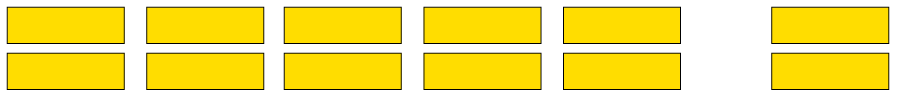
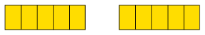

## Properties of numbers

### Different types of numbers

#### The natural numbers

The numbers that we use to count are
        called **natural numbers**:

\(1 \quad 2 \quad 3 \quad 4 \quad 5 \quad 6 \quad 7 \quad 8 \quad 9 \quad 10 \quad 11 \quad 12 \quad 13 \quad 14\)

Natural numbers
        have the following properties:

<Callout type="note" title="Note">
When you add two or more
          natural numbers, you get a natural number again.

When you multiply two or
          more natural numbers, you get a natural number again.
</Callout>

<Callout type="note" title="Note">
Mathematicians describe this by
          saying: The system of natural numbers is **closed under
            addition and multiplication**.
</Callout>

However, when a natural number is
        subtracted from another natural number the answer is not always
        a natural number again. For example, there is no natural number
        that provides the answer to \(5 - 20\).

Similarly, when a natural
        number is divided by another natural number the answer is not
        always a natural number again. For example, there is no natural
        number that provides the answer to \(10 \div 3\).

<Callout type="note" title="Note">
When subtraction or
          division is done with natural numbers, the answers are not
          always natural numbers.
</Callout>

<Callout type="note" title="Note">
The system of natural numbers
          is **not closed under subtraction or division**.
</Callout>

2. 2. Is there a smallest natural number, that means a natural number that is smaller than all other natural
                      numbers? If so, what is it?
   4. Is there a largest natural number, in other words, a natural number that is larger than all
                      other natural numbers? If so, what is it?
4. In each of the following cases, say whether the answer is a natural number or not.
   2. \(100 + 400\)
   4. \(100 - 400\)
   6. \(100 \times 400\)
   8. \(100 \div 400\)

#### The whole numbers

Although we don't use 0 for counting,
        we need it to write numbers. Without 0, we would need a special
        symbol for 10, all multiples of 10 and some other numbers. For
        example, all the numbers that belong in the yellow cells below
        would need a special symbol.

|  | 41 | 42 | 43 | 44 | 45 | 46 | 47 | 48 | 49 |
| --- | --- | --- | --- | --- | --- | --- | --- | --- | --- |
|  | 51 | 52 | 53 | 54 | 55 | 56 | 57 | 58 | 59 |
|  | 61 | 62 | 63 | 64 | 65 | 66 | 67 | 68 | 69 |
|  | 71 | 72 | 73 | 74 | 75 | 76 | 77 | 78 | 79 |
|  | 81 | 82 | 83 | 84 | 85 | 86 | 87 | 88 | 89 |
|  | 91 | 92 | 93 | 94 | 95 | 96 | 97 | 98 | 99 |
|  | 111 | 112 | 113 | 114 | 115 | 116 | 117 | 118 | 119 |

The natural numbers combined with 0
        is called the system of **whole numbers**.

If you are working with natural numbers and you
        add two numbers, the cd will always be different from any
        of the two numbers added. For example: \(21 + 25 = 46\) and \(24 + 1 =
        25\). If you are working with whole numbers, in other words
        including 0, this is not the case. When 0 is added to a number
        the answer is just the number you start with: \(24 + 0 = 24\).

For this reason, 0 is
        called the **identity element** for addition. In the set of
        natural numbers there is no identity element for addition.

2. Is there an identity element for multiplication in the whole
               numbers? Explain your answer.
4. 2. What is the smallest natural number?
   4. What is the smallest whole number?

#### The integers

In the set of whole numbers, no
        answer is available when you subtract a number from a number
        smaller than itself. For example there is no whole number that
        is the answer for \(5 - 8\). But there is an
        answer to this subtraction in the system of integers.

\(5 - 8 = -3\). The number
        \(-3\) is read as "negative 3" or "minus 3".

The whole numbers start with 0 and extend in
        one direction:

The integers extend in both directions:

**All whole numbers are also integers.** The
        set of whole numbers forms part of the set of integers. For
        each whole number, there is a negative number that corresponds
        with it. The negative number -5 corresponds
        to the whole number 5 and the negative number
        -120 corresponds to the whole number
        120.

Within the set of integers, the sum of two
        numbers can be 0.

For example \(20 + (-20) = 0 \)
        and \(135 + (-135) = 0\).

20 and -20 are called **additive inverses**
        of each other.

2. Calculate the following without using a calculator.
   2. \(100-165\)
   4. \(300-700\)
4. You may use a calculator to calculate the following:
   2. \(123-765\)
   4. \(385-723\)

#### The rational
        numbers

2. Five people share 12 slabs of
               chocolate equally among them.
   2. Will each person get more or less than two full slabs of chocolate?
   4. Can each person get another half of a slab?
      
   6. How
                      much more than two full slabs can each person get, if the
                      two remaining slabs are divided as shown here?
   8. Will each person get \(2\), \(4\) or 2\(\frac{2}{5}\) slab?

The system of integers does not
        provide an answer for all possible division questions. For
        example, as we see above, the answer for 12 \(\div\) 5 is not an
        integer.

To have answers for all possible division
        questions, we have to extend the number system to include
        fractions and negative fractions, in other words, numbers of
        the form \(\frac{\text{integer}}{\text{integer}}\). This system of numbers is called
        the **rational numbers**. We can represent rational numbers as common fractions
        or as decimal numbers.

2. Express the answers
               for each of the following division problems in two ways: using
               the common fraction notation and using the decimal notation for
               fractions.
   2. \(23 \div 10\)
   4. \(23 \div 5\)
   6. \(230 \div 100\)
   8. \(8 \div 10\)
4. Answer the statement by writing 'yes' or 'no' in the appropriate cell.
   | Statement | Natural numbers | Whole numbers | Integers | Rational numbers |
   | --- | --- | --- | --- | --- |
   | The sum of two numbers is a
                       number of the same kind (closed under addition). |  |  |  |  |
   | The sum of two numbers is
                       always bigger than either of the two numbers. |  |  |  |  |
   | When one number is
                       subtracted from another, the answer is a number of the
                       same kind (closed under subtraction). |  |  |  |  |
   | When one number is
                       subtracted from another, the answer is always smaller
                       than the first number. |  |  |  |  |
   | The product of two numbers
                       is a number of the same kind (closed under
                       addition). |  |  |  |  |
   | The product of two numbers
                       is always bigger than either of the two numbers. |  |  |  |  |
   | The quotient of two numbers
                       is a number of the same kind (closed under
                       division). |  |  |  |  |
   | The quotient of two numbers
                       is always smaller than the first of the two
                       numbers. |  |  |  |  |

#### Irrational numbers

Rational numbers do not provide for
        all situations that may occur in mathematics. For example,
        there is no rational number which will produce the answer 2
        when it is multiplied by itself.

\(2 \times 2 = 4\) and \(1 \times 1 = 1\), so clearly,
        this number must be between 1 and 2.

But there is no number which can be expressed
        as a fraction, in either the common fraction or the decimal
        notation, which will solve this problem. Numbers like these are
        called **irrational numbers**.

Here are some more examples of irrational
        numbers:

<Callout type="note" title="Note">
The rational and the irrational
          numbers together are called the **real numbers**.
</Callout>
