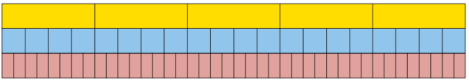

## Equivalent fractions

### The same number in different forms

2. How much money is each of the
               following amounts?
   2. \(\frac{1}{5}\) of R200
   4. \(\frac{2}{10}\) of R200
   6. \(\frac{4}{20}\) of R200
   Did you notice that all the answers
               are the same? That is because\(\frac{1}{5}\) , \(\frac{2}{10}\) and \(\frac{4}{20}\) are **equivalent fractions**. They are
               different ways of writing the same number.
   Consider this bar. It is divided into
               five equal parts.
   
   Each piece is **one fifth** of the
               whole bar.
4. Draw lines on the bar below so
               that it is approximately divided into ten equal parts.
   
   2. What part of the whole bar
                      is each of your ten parts?
   4. How many tenths is the
                      same as one fifth?
   6. How many tenths is the
                      same as two fifths?
   8. How many fifths is the
                      same as eight tenths?
6. Draw lines on the bar below so
               that it is approximately divided into 25 equal parts.
   
   2. How many twenty-fifths is
                      the same as two fifths?
   4. How many fifths is the
                      same as 20 twenty-fifths?
   In question 3(b) you found that \(\frac{4}{5}\)
               is equivalent to \(\frac{20}{25}\): these are just two different ways
   to describe the same part of the
               bar.
   This can be expressed by writing
               \(\frac{4}{5} = \frac{20}{25}\) which means that \(\frac{4}{5}\) and \(\frac{20}{25}\) are equivalent to each other.
8. Write down all the
               other pairs of equivalent fractions which you found while doing
               questions 2 and 3.
   The yellow bar is divided into
               fifths.
   
10. 2. Into what kind of
                      fraction parts is the blue bar divided?
   4. Into what kind of fraction
                      parts is the red bar divided?
   6. If you want to mark the
                      yellow bar in twentieths like the blue bar, into how many parts
                      do you have to divide each of the fifths?
   8. If you want to mark the
                      yellow bar in fortieths like the red bar, into how many parts
                      do you have to divide each of the fifths?
   10. If you want to mark the
                      yellow bar in *eightieths*, into how many parts do you
                      have to divide each of the fifths?
   12. If you want to mark the
                      blue bar in *eightieths*, into how many parts do you have
                      to divide each of the twentieths?
12. Suppose this bar is divided
               into 4 equal parts, in other words, quarters.
   
   2. If the bar is also divided
                      into 20 equal parts, how many of these smaller parts will there
                      be in each quarter?
   4. If each quarter is divided
                      into 6 equal parts, what part of the whole bar will each small
                      part be?
14. Complete this table of equivalent fractions, as far as you can
               using whole numbers. All the fractions in each column must be
               equivalent.
   | sixteenths | 8 | 4 | 2 | 10 | 14 | 12 |
   | --- | --- | --- | --- | --- | --- | --- |
   | eighths |  |  |  |  |  |  |
   | quarters |  |  |  |  |  |  |
   | twelfths |  |  |  |  |  |  |
   | twentieths |  |  |  |  |  |  |
   Equivalent fractions can be formed by
               multiplying the numerator and denominator by
   the same number. For example
               \(\frac{1}{5} = \frac{4\times{1}}{5\times{5}} = \frac{4}{20}\)
16. Write down five different
               fractions that are equivalent to \(\frac{3}{4}\).
18. Express each of the following
               numbers as twelfths:
   2. \(\frac{2}{3}\)
   4. \(\frac{3}{4}\)
   6. \(\frac{20}{25}\)
   8. \(\frac{1}{6}\)
   <Callout type="note" title="Note">
   You may divide the
                 numerator and denominator by the same number, instead of
                 multiplying the numerator and denominator by the same number.
                 This gives you a simpler fraction.
   the fraction
                 \(\frac{4}{12}\) is \(\frac{1}{3}\) by dividing both the numerator
   and denominator by the
                 common factor of 4.
   </Callout>
20. Convert each of the following
               fractions to their simplest form:
   2. \(\frac{40}{100}\)
   4. \(\frac{4}{16}\)
   6. \(\frac{5}{25}\)
   8. \(\frac{6}{30}\)
   10. \(\frac{6}{24}\)
   12. \(\frac{8}{88}\)

### Converting between mixed numbers and fractions

Numbers that have both
        whole number and fraction parts are called **mixed
          numbers**.

Examples of mixed numbers: \(3\frac{4}{5}\) \(2\frac{7}{8}\), and \(8\frac{3}{10}\)

Mixed numbers can be
        written in expanded notation, for example:

\(3 \frac{4}{5}\) means \(3 + \frac{4}{5}\)

\(2 \frac{7}{8}\) means \(2 +\frac{7}{8}\)

\(8\frac{3}{10}\) means \(8 + \frac{3}{10}\)

To add and subtract mixed numbers,
        you can work with the whole number parts and the fraction parts
        separately, for example:

\(3\frac{4}{5} + 13 \frac{3}{5} \\ = 16\frac{7}{5} \\ = 17
        \frac{2}{5}\)

\(13 \frac{3}{5} - 3 \frac{4}{5} \\ = 12 \frac{8}{5} - 3 \frac{4}{5}\) (we need to "borrow" a unit from 13,because we cannot subtract
        \(\frac{4}{5}\) from \(\frac{3}{5}\))

\(= 9 \frac{4}{5}\)

However, this method can be difficult
        to do with some examples - and it does not
        work with multiplication and division.

An alternative and preferred method is to
        convert the mixed number to an **improper fraction**, as
        shown in the example below:

<Callout type="note" title="Note">
**NOTE**

You can obtain the numerator of
          19 in one step by multiplying the denominator (5) by the whole
          number (3), and then adding the numerator (4).
</Callout>

3 \(\frac{4}{5} = 3 + \frac{4}{5} \\
        = \frac{15}{5} + \frac{4}{5}\\
        = \frac{19}{5}\)

So you can calculate
        \(3\frac{4}{5} + 13 \frac{3}{5}\) using this method:

\(3 \frac{4}{5} + 13 \frac{3}{5}\\
        = \frac{19}{5} + \frac{68}{5}\\
        = \frac{87}{5}\)

The answer must be converted to a
        mixed number again: \(\frac{87}{5}=17 \frac{2}{5}\)

2. Convert each of the following
               mixed numbers to improper fractions:
   2. \(5\frac{3}{5}\)
   4. \(2\frac{3}{8}\)
   6. \(3\frac{4}{7}\)
   8. \(4\frac{5}{12}\)
4. Convert each of the following
               improper fractions to mixed numbers:
   2. \(\frac{32}{5}\)
   4. \(\frac{25}{8}\)
   6. \(\frac{24}{9}\)
   8. \(\frac{37}{20}\)
