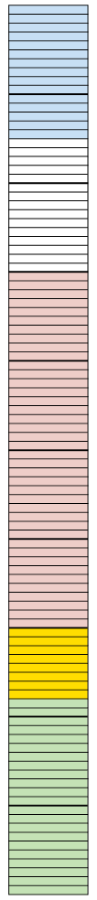

## Equivalent forms

### Fractions, decimals and percentage forms

2. The rectangle on the
               right is divided into small parts.
   
   2. How many of these small
                      parts are there in the rectangle?
   4. How many of these small parts are there
                      in one tenth of the rectangle?
   6. What fraction of the rectangle is
                      blue?
   8. What fraction of the rectangle is
                      pink?
   <Callout type="note" title="Note">
   Instead of "6 hundredths" we may say
                   "6 per cent" or, in short, "6%". It means the same thing.15
                   per cent of the rectangle on the right is blue.
   </Callout>
4. 2. What percentage of the rectangle is
                      green?
   4. What percentage of the rectangle is
                      pink?
      <Callout type="note" title="Note">
      0,37 and 37% and
                        \(\frac{37}{100}\) are different ways of writing
      the same value (**37
                          hundredths**).
      </Callout>
6. Express each of the
               following in three ways: as a decimal; a percentage and a
               fraction (in simplest form):
   2. 3 tenths
   4. 7 hundredths
   6. 37 hundredths
   8. 7 tenths
   10. 2 fifths
   12. 7 twentieths
8. Fill in the missing values in
             the table:
   | Decimal | Percentage | Common fraction
                       (simplest form) |
   | --- | --- | --- |
   | 0,2 |  |  |
   |  | 40% |  |
   |  |  | \(\frac{3}{8}\) |
   | 0,05 |  |  |
10. 2. Jannie eats a quarter of a
                    watermelon. What percentage of the watermelon is this?
   4. Sibu drinks 75% of the milk in a bottle.
                    What fraction of the milk in the bottle has he drunk?
   6. Jem used 0,18 of the paint in a tin. If
                    he uses half of the remaining amount the next time he paints,
                    what fraction (in simplest form) is left over?
