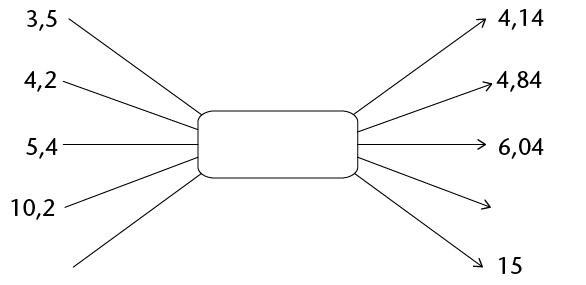

## Calculations with decimals

<Callout type="note" title="Note">
When you **add** and
          **subtract** decimal fractions:

Add tenths to tenths.

Subtract tenths from
          tenths.

Add hundredths to
          hundredths.

Subtract hundreds from
          hundredths.

And so on!

When you **multiply**
          decimal fractions, you change the decimals to whole numbers,
          do the calculation and last, change them back to decimal
          fractions.

**For example:** To
          calculate \(13,1 \times 1,01\), you first calculate \(131 \times
          101\) (which equals 13 231). Then, since you have multiplied
          the 13,1 by 10, and the 1,01 by 100 in order to turn them
          into whole numbers, you need to divide this answer by \(10
          \times 100\) (i.e. 1 000). Thus, the final answer is 13,231
</Callout>

<Callout type="note" title="Note">
When you **divide**
          decimal fractions, you can use equivalent fractions to help
          you.

**For example:**\( 21,7
          \div 0,7 = \frac{21,7}{0,7}=\frac{21,7}{0,7} \times
          \frac{10}{10}= \frac{217}{7}=31\)

Notice how you multiply
          both the numerator and denominator of the fraction by the
          same number (in this case, 10). Always multiply by the
          *smallest* power of ten that will convert both
            values to whole numbers.
</Callout>

### Calculations with decimals

*You are not
          permitted to use a calculator in this exercise. Ensure that you
          show all steps of your working.*

2. Calculate the value of the
               following:
   2. \( 3,3 + 4,83\)
   4. \( 0,6 + 18,3 + 4,4\)
   6. \( 9,3 + 7,6 -1,23\)
   8. \( (16,0-7,6) -0,6\)
   10. \( 9,43 - (3,61 +1,14)\)
   12. \( 1,21 + 2,5 - (2,3 - 0,23)\)
4. Calculate the value of the
               following:
   2. \( 4 \times 0,5\)
   4. \( 15 \times
                      0,02 \)
   6. \( 0,08 \times 0,04\)
   8. \( 0,02 \times 0,15\)
   10. \( 1,07 \times 0,2 \)
   12. \(0,016 \times 0,02\)
6. Calculate the value of the
               following:
   2. \( 7,2 \div 3 \)
   4. \(12 \div 0,3\)
   6. \(0,15 \div 0,5\)
   8. \( 10 \div 0,002\)
   10. \( 0,3 \div
                      0,006 \)
   12. \( 0,024 \div
                      0,08\)
8. Circle the value that is equal
               to or closest to the answer to each calculation:
   2. \( 3 \times 0,5\)
      A: 6
      B: 1,5
      C: 0,15
   4. \( 4,4 \div
                      0,2\)
      A 8,8
      B: 2,2
      C: 22
   6. \( 56 \times 1,675\)
      A: more than 56
      B: more than 84
      C: more than 112
10. Determine the operator
               and the unknown numbers in the following diagram, and fill them
               in:
   
12. Calculate the following:
   2. \( (0,1)^2\)
   4. \( (0,03)^2\)
   6. \((2,5)^2\)
   8. \(\sqrt{0,04}\)
   10. \(\sqrt{0,16}\)
   12. \(\sqrt{0,49}\)
   14. \( (0,2)^3\)
   16. \( (0,4)^3 \)
   18. \( (0,03)^3\)
   20. \(\sqrt[3]{0,064}\)
   22. \(\sqrt[3]{0,125}\)
   24. \(\sqrt[3]{0,216}\)
14. Calculate the following:
   2. \(2,5 \times 2 \div 10\)
   4. \( 4,2
                      - 5 \times 1,2\)
   6. \(\frac{5,4 + 7,35}{0,05}\)
   8. \(4,2 \div 0,21+0,45 \times 0,3\)
