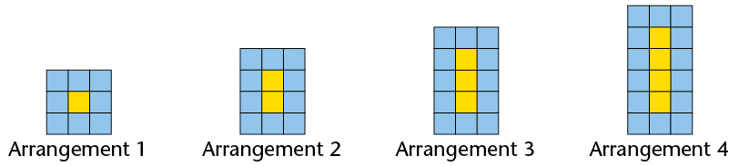
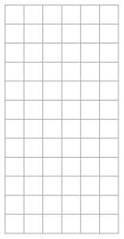
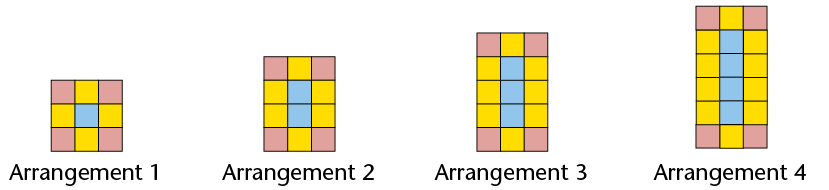
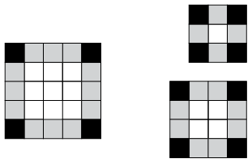
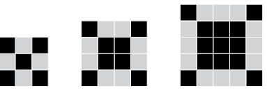
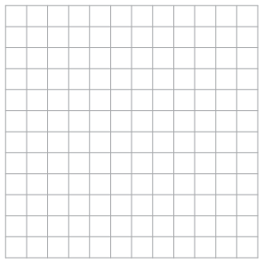
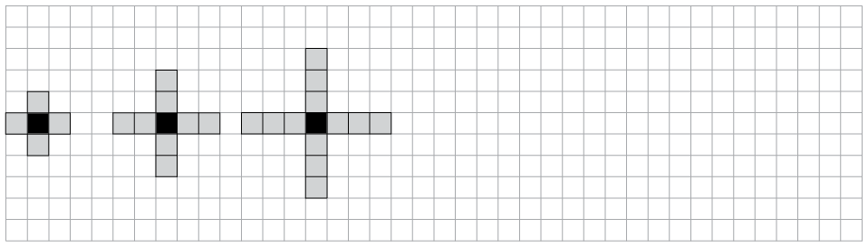
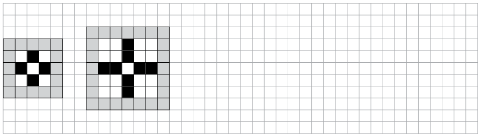
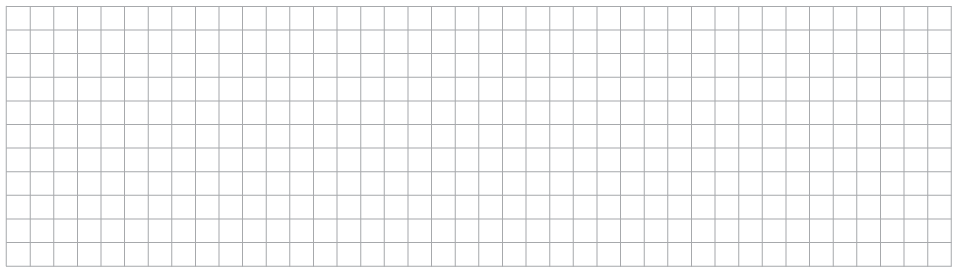

# Chapter 6: Patterns

Blue and yellow square tiles
          are combined to form the above arrangements.

2. How many yellow tiles are there in each
                 arrangement?
4. How many blue tiles are there in each
                 arrangement?
6. If more arrangements are made in the
                 same way, how many blue tiles and how many yellow tiles will
                 there be in arrangement 5? Check your answer by drawing the
                 arrangement on the grid on the right.
   
8. Complete this table.
   | Number of yellow tiles | 1 | 2 | 3 | 4 | 5 | 8 |
   | --- | --- | --- | --- | --- | --- | --- |
   | Number of blue tiles |  |  |  |  |  |  |
10. How many blue tiles will there be in a
                 similar arrangement with 26 yellow tiles?
12. How many blue tiles will there be in a
                 similar arrangement with 100 yellow tiles?
14. Describe how you thought to produce your
                 answer for (f)?

2. In these arrangements there are red
                 tiles too. Complete this table.
   
   | Number of blue tiles | 1 | 2 | 3 | 4 | 5 | 6 | 7 |
   | --- | --- | --- | --- | --- | --- | --- | --- |
   | Number of yellow tiles |  |  |  |  |  |  |  |
   | Number of red tiles |  |  |  |  |  |  |  |
4. How many red tiles are there in each
                 arrangement?
6. How many yellow tiles are there in each
                 arrangement?

<Callout type="note" title="Note">
The number of red tiles in
            arrangements like those in question 2 is **constant.** It
            is always 4, no matter how many blue and yellow tiles there
            are. The number of blue tiles is different for different arrangements. We can say the number of blue tiles **varies**. We can also say the number of blue tiles is a **variable**.
</Callout>

Is the number of yellow tiles
          in the above arrangements a constant or is it a variable?

Look at these three
          arrangements. They consist of black squares, grey squares and
          white squares.

2. Draw another arrangement of the same
                 kind, but with a different length, on the grid provided on the
                 right.
4. Describe what is constant in these
                 arrangements.
6. What are the variables in these
                 arrangements?

The smallest arrangement above may be
          called arrangement 1, the next bigger one may be called
          arrangement 2, and so on.

2. Complete the table for arrangements
                 like those in question 4.
   | Arrangement number | 1 | 2 | 3 | 4 | 5 | 6 | 7 | 10 | 20 |
   | --- | --- | --- | --- | --- | --- | --- | --- | --- | --- |
   | Number of black
                         squares |  |  |  |  |  |  |  |  |  |
   | Number of grey squares |  |  |  |  |  |  |  |  |  |
   | Number of white
                         squares |  |  |  |  |  |  |  |  |  |
4. How many grey squares do you think there
                 will be in arrangement 15? Explain your answer.
6. How many black squares do you think
                 there will be in arrangement 15? Explain your answer.
8. How many white squares do you think
                 there will be in arrangement 15? Explain your answer.

What are the next five numbers
          in each of the above patterns?

2. Draw the next arrangement that
                 follows the same pattern.
   
   
4. How many black tiles are there in the
                 arrangement you have drawn?
6. How many black tiles will there be in each of the next
                 four arrangements?

Number of grey
              squares

20

36

52

Number of white
              squares

256

225

625

2. Make two more
                 arrangements of black and grey squares so that a pattern
                   is formed.
   
4. Is there a constant in your pattern? If
                 yes, what is its value?
6. Is there a variable in your pattern? If
                 yes, give the values of the variable.

2. Make three more arrangements with
                 dots to form the sequence 1; 3; 6; 10; 15 . .
                   .
   
4. How many dots will there be in the sixth
                 and seventh arrangements? Explain how you got your answer.
6. How many dots are
                 there in arrangements 1 and 2 together?
8. How many dots are
                 there in arrangements 2 and 3 together?
10. How many dots are
                 there in arrangements 3 and 4 together?
12. How many dots are
                 there in arrangements 4 and 5 together?
14. Describe the pattern in your answers for
                 (c), (d), (e) and (f).

2. Draw two more arrangements to make a
                 pattern.
   
4. What are the variables in your
                 pattern?
6. The number of black squares is a
                 variable in these arrangements. The value of this variable is 4
                 in the first arrangement and 8 in the second arrangement. What
                 is the value of this variable in the third arrangement?
8. What are the values of each of the
                 variables in the fifth arrangement in your pattern? Explain
                 your answers.

2. Now make a pattern of your own.
   
4. Use this table to describe the variables
                 in your pattern, and their values.
   | Arrangement number | 1 | 2 | 3 | 4 | 5 | 6 |
   | --- | --- | --- | --- | --- | --- | --- |

2. Write the next three numbers in each
                 of the sequences below.
   Sequence A: 5 9 13 17 21
   Sequence B: 5 10 20 40 80
   Sequence C: 5 10 17 26 37
4. Describe the differences in the ways in
                 which the three sequences are formed.

You will now make a
          sequence with the first term 5.

          Write 5 on the left on
          the line below. Then add 8 to the first term (5) to form the
          second term of your sequence. Write the second term next to the
          first term (5) in the line below. Now add 8 to the second term
          to form the third term. Continue like this to form ten more
          terms.

<Callout type="note" title="Note">
The numbers in a sequence are
            also called the **terms** of the sequence.
</Callout>

<Callout type="note" title="Note">
A sequence can be formed by
            repeatedly adding or subtracting the same number. In this
            case the **difference** between consecutive terms in a
            sequence is **constant**. A sequence can be formed by repeatedly
            multiplying or dividing. In this case the **ratio** between consecutive terms is **constant**.
            A sequence can also be formed in such a way that neither the difference nor the ratio between
            consecutive terms is constant.
</Callout>

<Callout type="note" title="Note">
To write more terms of sequence
            A in question 1(a), you **added** 4 **repeatedly**.
</Callout>

<Callout type="note" title="Note">
To write more terms of sequence
            B in question 1(a), you **multiplied** by 2
            **repeatedly**.
</Callout>

<Callout type="note" title="Note">
To write more terms of sequence
            C in question 1(a) you did not add the same number each time,
            nor did you multiply by the same number.
</Callout>

Write the next three
          terms of each sequence. In each case also describe what the
          pattern is, for example "there is a constant difference of -5
          between consecutive terms".

2. 100; 92; 84; 76;
4. 1; 4; 9; 16;
6. 2; 8; 18; 32;
8. 3; 6; 11; 18;
10. 640; 320; 160;
12. 1; 2; 4; 7; 11;

In each case, follow the
          instruction to make a sequence with eight terms.

2. Start with 1 and multiply by 2
                 repeatedly.
4. Start with 256 and subtract 32
                 repeatedly.
6. Start with 256 and divide by 2
                 repeatedly.

Term number

1

2

3

4

5

6

7

8

9

10

Term value

5

13

21

29

37

45

53

61

69

77

In each case make a
          sequence by following the instructions. Write the term numbers
          and the term values in the given table.

2. Term 1 = 10. Add 15 repeatedly.
   | Term number |  |  |  |  |  |  |  |  |
   | --- | --- | --- | --- | --- | --- | --- | --- | --- |
   | Term value |  |  |  |  |  |  |  |  |
4. Term 1 = 10. Term value = 15 \(\times \) term
                 number - 5.
   | Term number |  |  |  |  |  |  |  |  |
   | --- | --- | --- | --- | --- | --- | --- | --- | --- |
   | Term value |  |  |  |  |  |  |  |  |
6. Term 1 = 10. Multiply by 2
                 repeatedly.
   | Term number |  |  |  |  |  |  |
   | --- | --- | --- | --- | --- | --- | --- |
   | Term value |  |  |  |  |  |  |
8. Term 1 = 20. \(\text{Term value} = 10 \times
                 2^\text{term number}\)
   | Term number |  |  |  |  |  |  |
   | --- | --- | --- | --- | --- | --- | --- |
   | Term value |  |  |  |  |  |  |
10. Term 1 = 10. Term value = \(10 \times
                 2^{\text{term number}-1}\)
   | Term number |  |  |  |  |  |  |
   | --- | --- | --- | --- | --- | --- | --- |
   | Term value |  |  |  |  |  |  |
12. Term 4 = 30. Add 5
                 repeatedly.
   | Term number |  |  |  |  |  |  |  |  |
   | --- | --- | --- | --- | --- | --- | --- | --- | --- |
   | Term value |  |  |  |  |  |  |  |  |

Instructions for
          forming a sequence are given in two different ways in question
          5. How would you describe the two different ways for giving
          instructions to form a sequence?

- A
            description of the **relationship between consecutive
              terms**. In other words the calculations that you do to a
            term to produce the next term, as in questions 5(a), (c)
            and (f) on the previous page. The first (or another) term
            must be given. This kind of formula has two parts, the
            first term, and the relationship between terms.
- A
            description of the **relationship between the value of the
              term and its position in the sequence**. This
            relationship describes the calculations that can be done
            **on the term number** to produce the **term value**,
            as in question 5(b), (d) and (e) on the previous page.

Choose any whole number
          smaller than 10 as the first term of a sequence.

2. Use your chosen first term to form a
                 sequence by adding 5 repeatedly.
4. Multiply each term number below by 5 to form a sequence:
   | Term number | 1 | 2 | 3 | 4 | 5 | 6 | 7 | 8 |
   | --- | --- | --- | --- | --- | --- | --- | --- | --- |
   | Term value |  |  |  |  |  |  |  |  |
6. What is similar about the two sequences
                 you have formed?
8. Now fill in your own sequence in the
                 same table:
   | Term number | 1 | 2 | 3 | 4 | 5 | 6 | 7 | 8 |
   | --- | --- | --- | --- | --- | --- | --- | --- | --- |
   | Term value in (b) |  |  |  |  |  |  |  |  |
   | Term value of your own
                         sequence in (a) |  |  |  |  |  |  |  |  |
10. What must you add to or subtract from
                 each term value in (b) to get the same sequence as the one you
                 made in (a)?
12. Fill in the
                 following to write a formula for each sequence:
   For the sequence in
                 (b): Term value =______ (term number) ______
   For the sequence in (a): Term value =______ (term
                 number) ______

Now you are going to
          repeat what you did in question 1, with a different set of
          sequences.

In this sequence, the
          term number is multiplied by 3 to get the term value.

| Term number | 1 | 2 | 3 | 4 | 5 | 6 | 7 | 8 |
| --- | --- | --- | --- | --- | --- | --- | --- | --- |
| Term value | 3 | 6 | 9 | 12 | 15 | 18 | 21 | 24 |

Now make a formula describing the
          relationship of the **term
              value** to the **term
              number** for each of these sequences:

2. The sequence that starts with 8 and is
                 formed by adding 3 repeatedly.
4. The sequence that starts with 12 and is
                 formed by adding 3 repeatedly.
6. The sequence that starts with 2 and is
                 formed by adding 3 repeatedly.

Write the first eight
          terms of each of the following sequences, and in each case
          describe how each term can be calculated from the previous
          term.

2. \(\text{Term value} = 10 \times \text{term number} +
                 5\)
   | Term number | 1 | 2 | 3 | 4 | 5 | 6 | 7 | 8 |
   | --- | --- | --- | --- | --- | --- | --- | --- | --- |
   | Term value |  |  |  |  |  |  |  |  |
4. \(\text{Term value} = 5
                 \times \text{term number} - 3\)
   | Term number | 1 | 2 | 3 | 4 | 5 | 6 | 7 | 8 |
   | --- | --- | --- | --- | --- | --- | --- | --- | --- |
   | Term value |  |  |  |  |  |  |  |  |

For each sequence,
          write a formula to obtain each term from the previous term, and
          also try to write formula which relates each term to its
          position in the sequence. Check both your formulae by applying
          them, and write the results in the table.

2. 7; 11; 15; 19; 23; 27; 31; 35; 39; 43
   **A.** Relationship between
                 consecutive terms:
   **B.** Relationship between term
                 value and its position in sequence:
   | Term number | 1 | 2 | 3 | 4 | 5 |
   | --- | --- | --- | --- | --- | --- |
   | Term value using A |  |  |  |  |  |
   | Term value using B |  |  |  |  |  |
4. 60; 57; 54; 51; 48; 45; 42; 39; 36
   **A.** Relationship between
                 consecutive terms:
   **B.** Relationship between term
                 value and its position in sequence:
   | Term number | 1 | 2 | 3 | 4 | 5 |
   | --- | --- | --- | --- | --- | --- |
   | Term value using A |  |  |  |  |  |
   | Term value using B |  |  |  |  |  |
6. 1; 2; 4; 8; 16; 32; 64; 128
   **A.** Relationship between
                 consecutive terms:
   **B.** Relationship between term
                 value and its position in sequence:
   | Term number | 1 | 2 | 3 | 4 | 5 |
   | --- | --- | --- | --- | --- | --- |
   | Term value using A |  |  |  |  |  |
   | Term value using B |  |  |  |  |  |
