# Chapter 7: Functions and relationships

You are going to choose a
          number, multiply it by 5, and subtract the answer from 50.

2. Choose any number from set A and do the
                 above calculations.
4. Choose any number from set B and do the
                 above calculations.
6. If you choose any other number from set
                 B, do you think the answer will also be a negative number?

2. Write down all the different output
                 numbers that will be obtained when the calculations \(50
                 - 5x\) are performed on the different
                 numbers in set A.
   <Callout type="note" title="Note">
   **Output numbers** are
                   numbers that you obtain when you apply the rule to the input
                   numbers.
   </Callout>
4. Write down the output numbers that will
                 be obtained when the formula \( 50 - 5x\)
                 is applied to set B.

2. Complete the following table for set
                 A:
   | Input numbers | 1 | 2 | 3 | 4 | 5 | 6 | 7 | 8 | 9 |
   | --- | --- | --- | --- | --- | --- | --- | --- | --- | --- |
   | Values of \( 50
                         - 5x\) |  |  |  |  |  |  |  |  |  |
4. Complete the following table for set
                 B:
   | Input numbers | 20 | 30 | 40 | 50 | 60 | 70 | 80 | 90 |
   | --- | --- | --- | --- | --- | --- | --- | --- | --- |
   | Values of \(50
                         - 5x\) |  |  |  |  |  |  |  |  |

In this question your set of
          input numbers will be the even numbers 2; 4; 6; 8; 10; ...

2. What will all the output numbers be if
                 the rule \(2n + 1\) is applied to the set of even numbers?
                 Write a list.
4. What will the output numbers be if the
                 rule \(2n- 1 \)is applied?
6. What will the output numbers be if the
                 rule \(2n + 5\) is applied?
8. What will the output numbers be if the
                 rule \(3n + 1\) is applied?

2. What kind of output numbers will be
                 obtained by applying the rule \(x - 1
                 000\) to natural numbers smaller than 1 000?
4. What kind of output numbers will be
                 obtained by applying the rule \(\frac{x}{10} + 10\) to natural numbers
                 smaller than
                 10?
6. If you use the rule \( 30x + 2\), and
                 use input numbers that are positive fractions with denominators
                 2, 3 and 5, what kind of output numbers will you obtain?

A quantity that changes is
        called a **variable quantity** or just a
        **variable**.

If one variable quantity is
        influenced by another, we say there is a **relationship**
        between the two variables. You can sometimes work out which
        number is linked to a specific value of the other
        variable.

The output number can also be
        called the output value, or the value of the expression,
        which is \(10x + 5\) in
        this
        case.

Arelationship between two
        variables in which there is only one output number for each
        input number, is called a **function**.

- With a
            table that shows some values of the two variables. A table
            shows clearly which value of the output variable
            corresponds to each particular value of the input
            variable.
- A flow
            diagram, which shows what calculations are to be done to
            calculate the output number that corresponds to a given
            input variable.
- A
            formula, which also describes what calculations are to be
            done to calculate the output number that corresponds to a
            given input variable.
- A
            graph.

Complete the flow diagram:

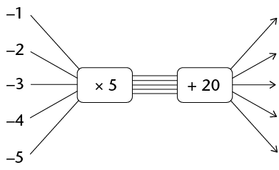

A completed flow diagram shows two
          kinds of information:

- It
            shows what calculations are done to produce the output
            numbers.
- It
            shows which output number is connected to which input
            number.

 Each input
        number is multiplied by 5, then 20 is added, to produce the
        output numbers.
 Which
        output numbers correspond to which input numbers.

The output numbers of a
        function are also called **function values**. Hence the
        formula can also be written as

*function value* =
        \(5x + 20\)

Complete this table for the
          function described by \(5x + 20\):

| Input numbers | -1 | -2 | -3 | -4 | -5 |
| --- | --- | --- | --- | --- | --- |
| Function values |  |  |  |  |  |

Draw a graph of this function
          below.

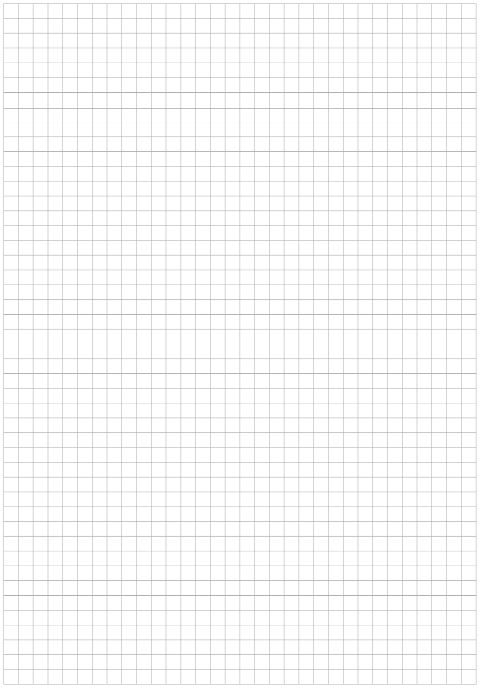

A graph of a certain function
          is given below. Complete the table for this function.

| Input numbers |  |  |  |  |  |
| --- | --- | --- | --- | --- | --- |
| Function values |  |  |  |  |  |

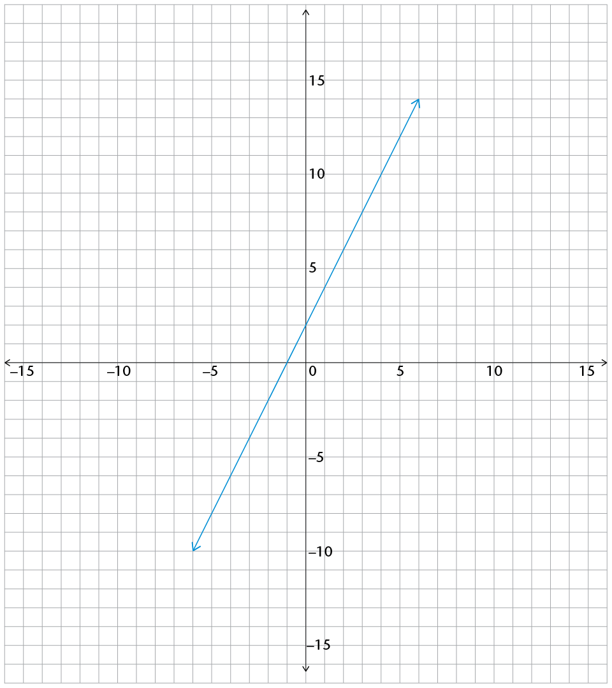

a flow diagram

a table of values for the set of
          integers from -5 to 5

a graph

The relationship described by
          the expression \(3x + 4\)

The relationship described by
          the expression \( 2x - 5\)

The relationship described by
          the expression \(\frac{1}{2}x +2\)

The relationship described by
          the expression \(-3x + 4\)

The relationship described by
          the expression \(2,5x + 1,5\)

The relationship described by
          the expression \(0,2x + 1,4\)

The
          relationship described by the expression \(
          -2x-4\)

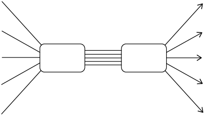

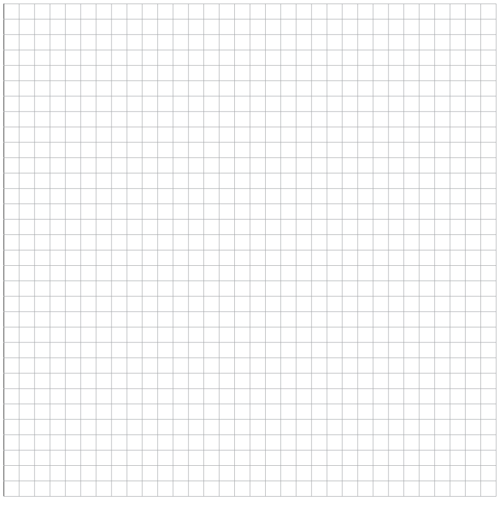

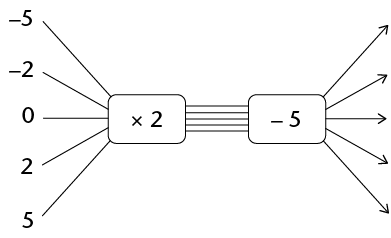

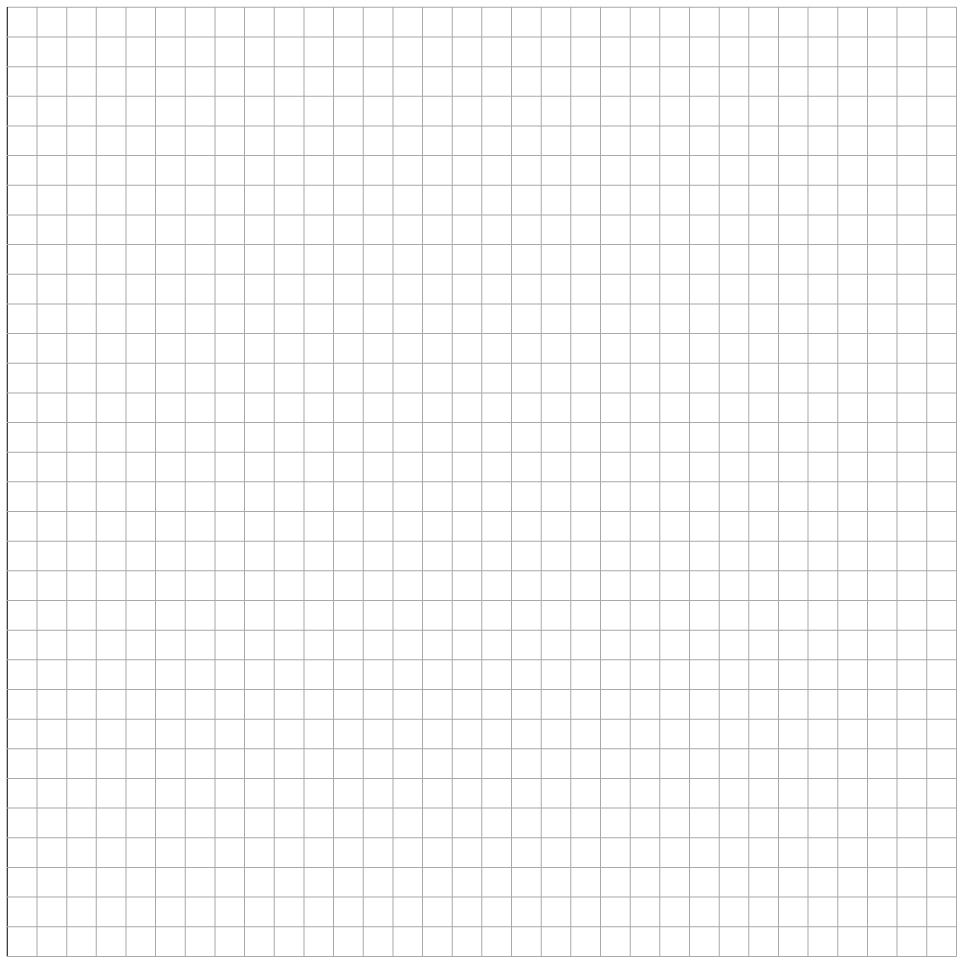

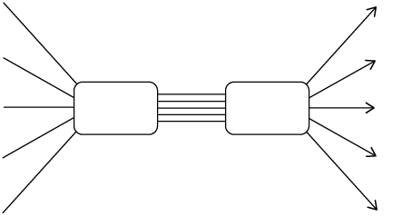

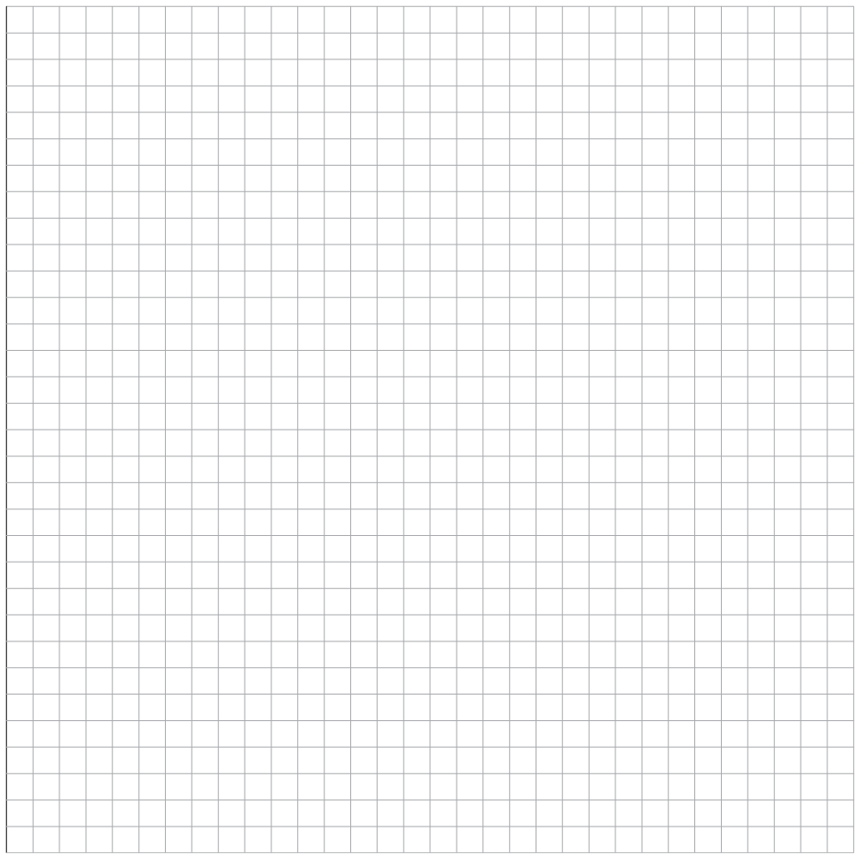

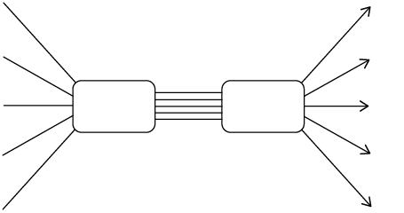

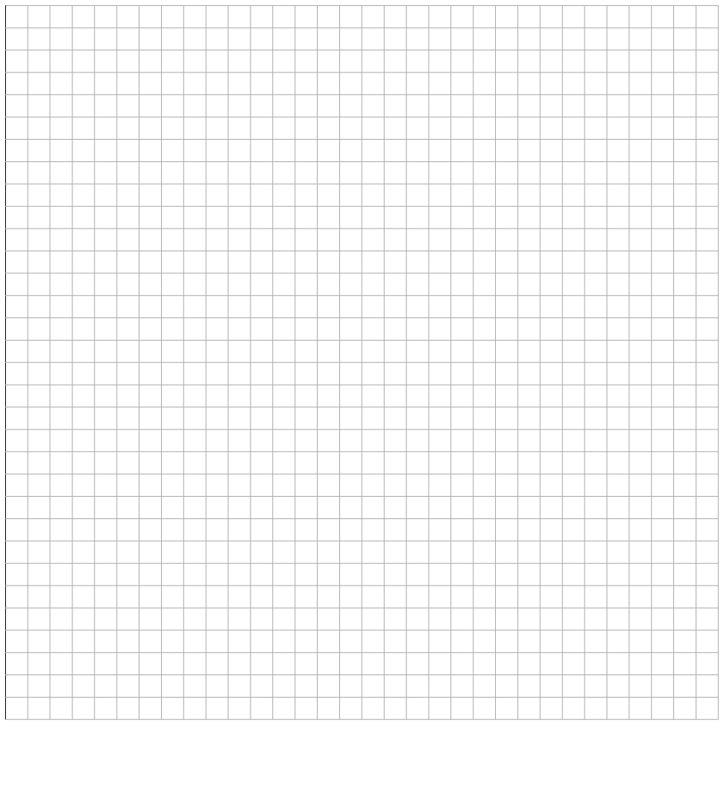

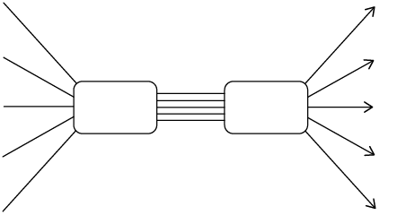

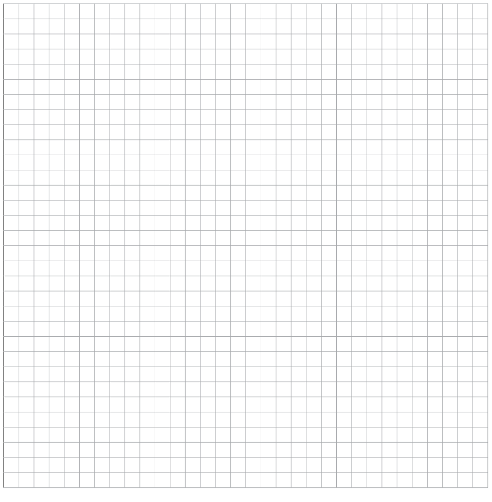

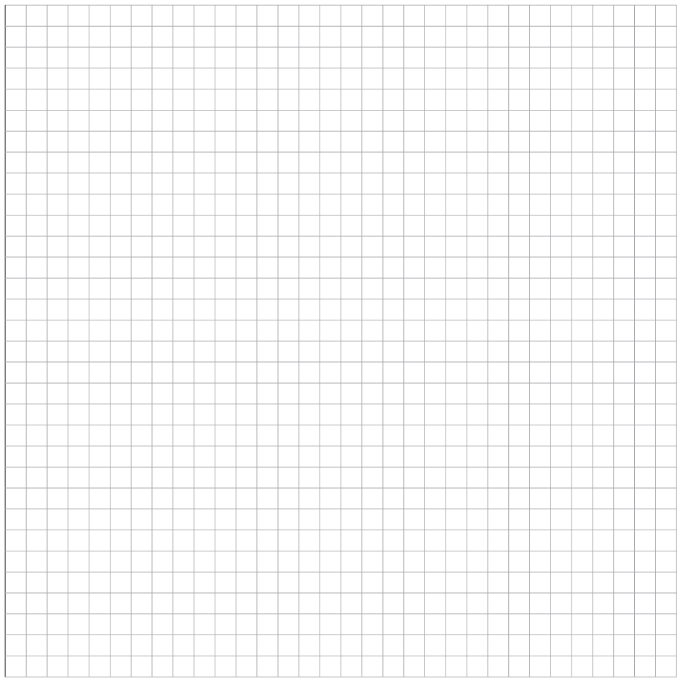

