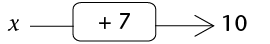
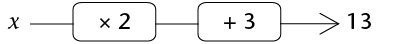
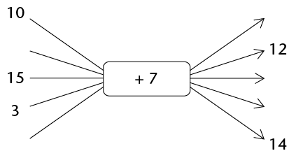
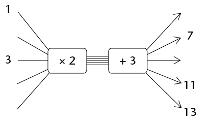
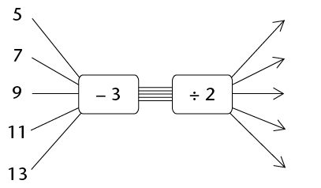
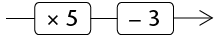
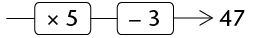

## Solving equations using additive and multiplicative inverses

2. In each case find the value of
               \(x\):
   2. 
   4. 
4. Complete the flow diagrams.
               You have to fill in all the missing numbers.
   <Callout type="note" title="Note">
   To find the second input number
                 you may say to yourself, "After I added 7, I had 12.
                 What did I have before I added
                   7?"
   </Callout>
   2. 
      <Callout type="note" title="Note">
      To find the input number that
                        corresponds to 13, you may ask yourself, "What did I have before I added 3?"
                        and then, "What did I have
                          before I multiplied by 2?"
      </Callout>
   4. 
6. Use your answers for question
               2 to check your answers for question 1.
8. Describe the
               instructions in flow diagram 2(b) in words, and also with a
               symbolic expression.
10. Complete the flow diagram.
   <Callout type="note" title="Note">
   This flow diagram is called the
                 **inverse** of the flow diagram in question 2(b).
   </Callout>
   
12. Compare the input
               numbers and the output numbers of the flow diagrams in question
               2(b) and question 5. What do you notice?
14. 2. Add 5 to any number and then subtract
                      5 from your answer. What do you get?
   4. Multiply any number by 10 and then
                      divide the answer by 10. What do you get?
      <Callout type="note" title="Note">
      If you add a number and
                        then subtract the same number, you are back where you
                        started. This is why addition and subtraction are called **inverse operations**. If you multiply by a number and then divide by the same number, you are back where you started. This is why multiplication and division are called **inverse operations**
      </Callout>
      The expression \(5x-3\) says *"multiply by 5 then
                        subtract 3"*.
                      This instruction can also be given with a flow diagram:
      
      The equation \(5x - 3 = 47\) can also be written as
                      a flow diagram:
      
16. Solve the equations
               below. You may do this by using the inverse operations. You may
               write a flow diagram to help you to see the operations.
   2. \(2x + 5 = 23\)
   4. \(3x - 5 =
                      16\)
   6. \(5x - 60 = -5\)
   8. \(\frac{1}{3}x + 11 = 19\)
   10. \(10(x+ 3) = 88\)
   12. \(2(x -
                      13) = 14\)
