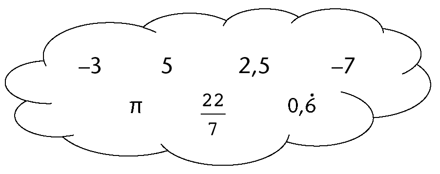
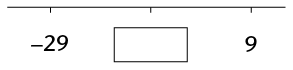
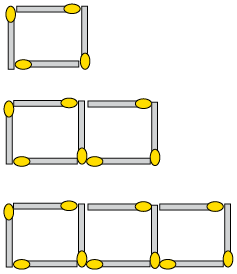
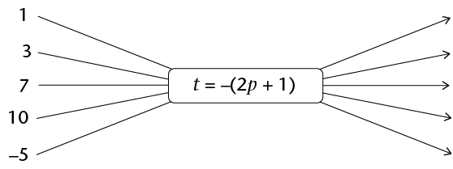
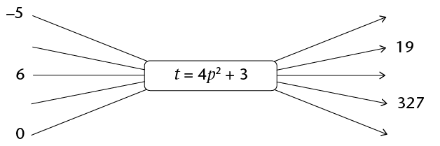
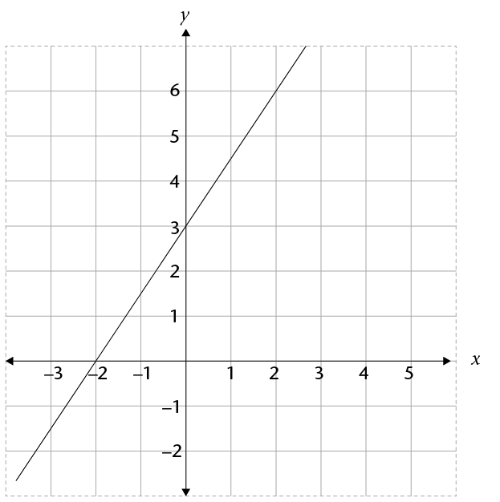
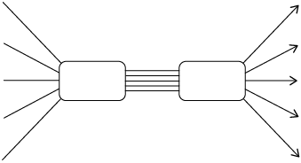

## Revision

Remember to
        show all the steps in your working.

### Whole numbers

2. Write all the numbers from the cloud in the table below, and
               place a tick in all
               the column(s) of the type of numbers they are. The first number
               has been completed for you:
   
   | Number value | Number system |
   | --- | --- |
   | Real numbers | Natural numbers | Integers | Rational numbers | Irrational numbers |
   | -3 | ✔ |  | ✔ | ✔ |  |
4. The Ndlovu family is
               travelling to the Kruger National Park on holiday. Here is a
               summary of their journey:
   | Time | Odometer reading
                       (km) | Description |
   | --- | --- | --- |
   | 06:12 | 123
                       564 | Leave home |
   | 08:32 | 123
                       785 | Stop for breakfast and petrol |
   | 09:18 | 123
                       785 | Leave petrol station |
   | 11:34 | 124
                       011 | Stop for toilet break |
   | 11:51 | 124
                       011 | Leave petrol station |
   | 13:32 | 124
                       175 | Reach Kruger gate |
   2. Calculate the length of time the journey
                      took, in hours. Give your answer as mixed number.
   4. Calculate the average speed of the
                      journey, correct to one decimal place.
6. A car travelling at an
               average speed of 110 km/h takes \(2 \frac{1}{4}\) hours to complete a journey. If the
               return journey needs to be completed in 2 hours, calculate the
               average speed that must be maintained.
8. If four tins of bully beef
               cost R75,80, how much money would seven similar tins cost?
10. A farmer has enough
               chicken feed to feed 300 hens for 20 days. If he buys 100 more
               hens, how long would the same amount of chicken feed last
               before it runs out?
12. How long will it take R5 000
               invested at 7,2% simple interest p.a. to grow to R5 900?
14. Chardonnay wishes to
               buy a new TV set costing R7 499. She does not have enough money
               and so needs to buy it on hire purchase. The store requires a
               10% deposit and then equal monthly payments of R\(x\) for 2 years. If the simple
               interest charged on the account is 15%, calculate the value of
               \(x\).
16. How much interest will
               Tebogo get on R12 500 deposited for 21 months in a bank account
               that provides 5,3% compound interest per annum?

### Integers

All the
        questions in this section should be answered without using a
        calculator.

2. Write a number in each
               box to make the calculations correct:
   2. \(☐ + ☐ = -34\)
   4. \(☐ + ☐ = -34\)
4. These questions show
               sequences of numbers. Fill the correct values in the boxes:
   2. 18; 10; 2; ☐
   4. 2; -10; 50; ☐
   6. -6
                      386; -6 392; -6 398; ☐
6. This question shows a
               number line in which the missing number is halfway between the
               other two numbers. Fill the correct value into the box:
   
8. Calculate the following:
   2. \(28 - (-15)\)
   4. \((-5)(12)(-7)\)
   6. \(5 + 5 \times -6\)
   8. \(\frac{(\sqrt{81})(-2)^{3}}{-(-3)^{2}}\)
   10. \(\frac{(-3)^{2} \sqrt[3]{216}}{(-9)(-3)}\)
10. Augustus ruled the Roman
               Empire from 27 BC to AD 14. For how many years did he rule?

### Fractions

All the questions in this section
        should be answered without using a calculator.

2. Simplify the
               following:
   2. \(\sqrt{\frac{36}{81} x^8}\)
   4. \(\frac{5}{2}x^{2} - \frac{5}{4}x^{2}\)
   6. \((\frac{3}{4}xy^{3})( \frac{4}{9}y)\)
4. Simplify the
               following:
   2. \(\frac{4 x^{10}}{8x^5}\)
   4. \(\frac{5}{x} - \frac{1}{x}\)
   6. \(\frac{5x}{6y^2}\times\frac{3y}{15x}\)
   8. \(\frac{x+2}{4z^2}\div\frac{4(x+2)}{2z^3}\)

### The decimal notation for fractions

All the questions in this section
        should be answered without using a calculator.

2. Calculate the following:
   2. 27,49 - 6,99
   4. \(0,03 \times 1,4\)
   6. \(1,44 \div 0,012\)
4. Simplify the following:
   2. \(\sqrt{0.04 x^{16}}\)
   4. \(3.5x^{2} - 4,6 x^{2}\)
   6. \((1,2 x^{2}y^{3})(5y x^{2})\)
6. Simplify
             the following:
   2. \(\frac{0.2 x^{15}}{0.01x^5}\)
   4. \(\frac{0.45}{x} - \frac{1.35}{x}\)
   6. \(\frac{0,5 x^{3}}{4.5y^2} \times \frac{3y}{2,5x}\)
   8. \(\frac{2,5 x^{3}}{2y^2} \div \frac{0,5x}{0,03y^6}\)

### Exponents

All the questions in this section
        should be answered without using a calculator, unless otherwise
        specified in the question.

2. Write the following numbers in
             scientific notation:
   2. 2 500 001
   4. 0,000 304 5
4. Write the following number in
             "normal" notation: \(9,45 \times 10^{-5}\).
6. Which of the following numbers
             is bigger: \(4,7 \times 10^{-9}\) or \(5,12 \times 10^{-10}\)?
8. Calculate the following,
             giving your answer in scientific notation:
   2. \((5,9 \times 10^{6} ) - (4,7
                    \times 10^{6})\)
   4. \((5,9 \times 10^{6} ) +
                    (4,7 \times 10^{5})\)
   6. \((7,2 \times 10^{-4} ) \times (2 \times
                    10^{2})\)
10. Calculate the
             following, giving your answer as an ordinary decimal number. A
             calculator may be used:
   2. \((6,3 \times 10^{-4} ) - (1,9 \times
                    10^{-3})\)
   4. \((5,8 \times 10^{-7} ) \div (8 \times 10^{-11})\)
12. Simplify the following,
             leaving all answers with positive exponents:
   2. \(3^{-2}\)
   4. \(2^{7} \times 6^{-3} \times 3^{2}\)
   6. \(\frac{2y^{-3}}{y^3}\)
   8. \((2x^{6}) ^{-3}\)
   10. \((2x^{7}) (2,5x^{-8})\)
   12. \((-3a^{2}bc)^2 ( -5ac^{-2})\)
   14. \(\frac{(2d^2e)^2}{(4d^{-3}e^2)^{-1}}\)
14. Solve the following
             equations:
   2. \(3 \times 3^{x} = 81\)
   4. \(2^{x+1} = 0,125\)
   6. \(4^{x} +10 = 74\)

### Patterns

2. Create a sequence that
             fits this description: the first term is negative, and each
             successive term is obtained by squaring the previous term and
             then subtracting 10.
4. Write down the first four
               terms of your created sequence.
6. For each of the
             following sequences, (i) write in words the rule that describes
             the relationship between the terms in the sequence, and (ii)
             use the rule to extend the sequence by three more terms:
   2. -5; -2; 10; -20;...
   4. -4,5; -6,25; -8;...
8. In this question you
             are given the rule by which each term of the sequence can be
             found. In all cases, n is the position of the term.
             Determine the first three terms of each of the sequences:
   2. \(3 - 5n\)
   4. \(2n ^{2} - 3n + 1\)
10. 2. Write down the rule by which each
                    term of the sequence can be found (in a similar format to those
                    given in question 3, where n is the position of the term):
                    -15; -12; -9; ...
   4. Use this rule to find the value of the
                    150th term of the sequence.
12. Determine the pattern and then write the missing values in the table below:
   | Position in sequence | 1 | 2 | 3 | 4 | 5 |  | 10 |  |  |
   | --- | --- | --- | --- | --- | --- | --- | --- | --- | --- |
   | Value of the term | 2 | 5 | 10 | 17 |  |  |  |  | 226 |
14. The
             picture below shows a pattern created by matchsticks.
   
   2. Draw your own series of matchstick
                    patterns in which there is a common difference between each
                    pattern. It must be different to all the matchstick patterns
                    shown in Chapter 6 and this chapter, and should contain the
                    first three
                    matchstick patterns in the series.
   4. Write in words the rule that describes
                    the number of matchsticks needed for each new pattern.
   6. Use the rule to determine the missing
                    values in the table below, and fill them in:
      | Number of the pattern | 4 | 5 | 6 | 7 |  | 50 |
      | --- | --- | --- | --- | --- | --- | --- |
      | Number of matches needed |  |  |  |  |  |  |

### Functions and relationships

2. 2. Use the given formula to calculate
                    the values of t,
                    given the values of *p*:
      
   4. Use the given formula to calculate the
                    missing input values, p, and output values,
                    t.
      
4. Consider the values in the
             table below:
   | \(x\) | -2 | -1 | 0 | 1 |  | 4 |  | 12 |  |  |
   | --- | --- | --- | --- | --- | --- | --- | --- | --- | --- | --- |
   | \(y\) | -4 | -1 | 2 | 5 |  |  |  |  |  | 65 |
   2. Write, as an algebraic formula, the rule
                    for finding the y-values in the table. The
                    formula is in the form \(y = ax + b\), where \(a\) and \(b\) are integers.
   4. Use the rule to determine the missing
                    values in the table, and fill them in.
6. Consider the graph shown
             below:
   
   2. Complete the following table by reading
                    off the coordinates of points on the graph:
      | \(x\) | -3 | -2 | -1 | 0 | 1 | 2 |
      | --- | --- | --- | --- | --- | --- | --- |
      | \(y\) |  |  |  |  |  |  |
   4. Write down an algebraic formula for the
                    graph, in the form \(y = \)...
   6. Complete the flow diagram below to
                    represent the relationship shown on the graph:
      

### Algebraic expressions

2. Simplify
             as far as possible:
   2. \( (2x^{2} - 4x^{2}) ^{3}\)
   4. -\( 2x^{2} (5x^{3} - 3x^{2} + 2x - 5)\)
   6. \( (4b^{2} - 7b^{2} (5b^{-2} + 3b^{-1} - 7)\)
   8. \(\frac{18x^2 - 12x + 2}{6x}\)
   10. \((2x+5)(3x-1)\)
   12. \((4a - 3)^{2}\)
   14. \(\frac{6x^3 -2(3x)(4x) + x}{4x^2}\)
4. Simplify as far as
             possible:
   2. \(4(a-2b) - 5(3b + a)\)
   4. \(5 +2(x^2 +5x +3)\)
   6. \(3x(2x^2 -3x + 4) - 3(5 - 2x)\)
   8. \((a + 3b - 2c) - (4a + b - c) - (2b - c +3a)\)
   10. \(4(3x^2 + x - 4) - (x + 3)^{2}\)

### Equations

2. Solve the following
             equations:
   2. \(4 - 3x = -2\)
   4. \(4(2x- 1) = -8\)
   6. \(2x + 1 = 3(2x - 1)\)
   8. (\(x + 2)(x - 4) = x^{2} + 5x - 1\)
4. Thomas is
   *z* years old and Tshilidzi is twice as old as
             Thomas. The sum of their ages is 42.
   2. Write this information in an equation
                    using the variable \(z\).
   4. Solve the equation to find Tshilidzi's
                    age.
6. The base of a triangle
             is \((1,5x + 6)\) cm
             and the height is 4 cm. The area of the triangle is 24
             cm2.
   2. Write this information in an equation in
                    \(x\).
   4. Solve the equation to determine the
                    value of \(x\).
   6. What is the length of the base of the
                    triangle?
8. Solve for\(x\):
   2. \(3^{x} = 9\)
   4. \(2^{x+1} = 16\)
