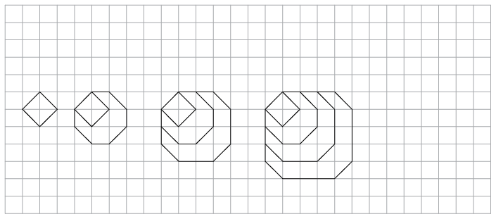
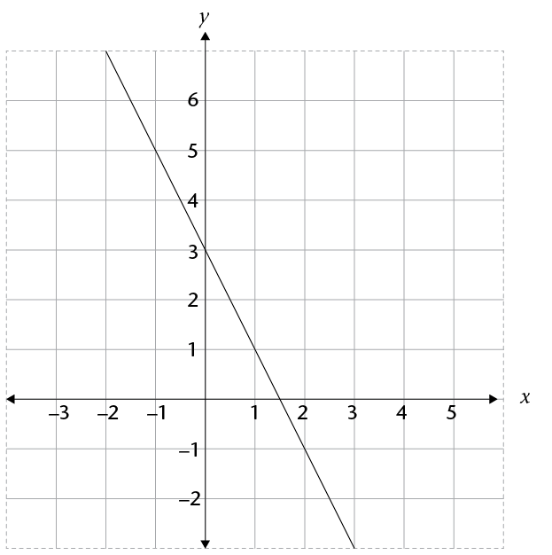

## Assessment

In this section, the numbers in
        brackets at the end of a question indicate the number of marks
        the question is worth. Use this information to help you
        determine how much working is needed. The total number of marks
        allocated to the assessment is 75.

2. Gareth completed the following
             number classification:
   | Number value | Number system |
   | --- | --- |
   | Real numbers | Natural numbers | Integers | Rational numbers | Irrational numbers |
   | - 1,5 | ✔ |  | ✔ | ✔ |  |
   | \(\sqrt{2}\) | ✔ |  |  | ✔ |  |
   2. Gareth
                    has made some errors. Complete the following table by putting
                    the ticks in the correct boxes: (2)
      | Number value | Number system |
      | --- | --- |
      | Real numbers | Natural numbers | Integers | Rational numbers | Irrational numbers |
      | - 1,5 |  |  |  |  |  |
      | \(\sqrt{2}\) |  |  |  |  |  |
   4. Explain why you have made the
                    changes you have. (2)
4. Pheto
             invested R1 500 for 2 years in a bank account. At the end of
             this period, the initial investment had grown to R1 717,50.
             What simple interest rate did the bank give him? (Assume that
             the rate remained unchanged for the entire period.) Give your
             answer as a percentage. (3)
6. A Benthian changed 2 500 Bendollars to Darsek when he
             visited the Klingon Empire, and received 2 000 Darsek after the
             3% commission had been charged. Determine the Bendollars :
             Dasek exchange rate and then copy and complete the following
             sentence: "1 Klingon Darsek = ___ Bendollars". The missing
             value should be written correct to three decimal places.
             (3)
8. What is the difference in height between the highest point
             on the Earth's surface (Mt Everest: 8 848 m above sea level) and the
             deepest point of the sea (the bottom of the Marianas Trench, 10
             994 m below sea
             level)? (1)
10. Write down two numbers that subtract to give an answer of
             21. One of the numbers must be positive and the other negative.
             (2)
12. 2. What is the value of \((-1)^{1000 001}\) ?
                    (1)
   4. Explain how you can know the
                    answer in (a) without needing a calculator. (1)
14. Simplify the following, without using a calculator. Show all
             steps of your working:
   2. \(\frac{5}{2}x -\frac{11}{4}x + 1,125x\)
   4. \(\sqrt[3]{\frac{0,027 x^7}{316x}}\)
   6. \(\frac{0,4x}{10} \times \frac{20x}{0,03} \div \frac{8x^{2}}{5}\)
   8. \(\frac{x}{4}+ [8x (x + 1) \times \frac{0,5}{x+1}]\)
16. The
             diameter of a carbon atom is 0,000000000154 metres. Write this
             in scientific notation. (2)
18. Simplify the following,
             leaving all answers with positive exponents:
   2. \(3^{-9} \times 3^{4}\)
   4. \(\frac{(3d^3e^2)^3}{(2d^{-4}e)^-1}\)
20. Solve for \(x\): \(9^{2x-3} = 3^{x}\)
22. Consider the following
             sequence: 6 000; -1 500; 375; ...
   2. Extend the sequence by two
                    more terms. (2)
   4. Is this the correct rule for
                    the sequence (where n is the position of the term
                    in the sequence): \(6 000(0,25)^{n-1}\)? Explain your answer. (2)
24. The
             following figure shows a pattern created by matchsticks.
   
   2. Draw the 5th diagram in the
                    pattern alongside the picture above. (2)
   4. The first two terms in the
                    sequence created by the number of matchsticks in each pattern
                    is 4; 11. Write down the next three terms in the sequence.
                    (2)
   6. Write in words the rule that
                    describes the relationship between the terms in the sequence.
                    (2)
26. Consider the values in the
             table below:
   | \(x\) | -2 | -1 | 0 | 1 |  | 5 |  | 16 |  |  |
   | --- | --- | --- | --- | --- | --- | --- | --- | --- | --- | --- |
   | \(y\) | -10 | -3 | -2 | -1 |  |  |  |  |  | 7 998 |
   2. Write the rule for finding
                    the y-values in the
                    table as an algebraic formula. (2) (Hint: Look at the cubes of
                    the numbers.)
   4. Use the rule to determine the
                    missing values in the table, and fill them in. (3)
28. Consider the following
             graph:
   
   2. Complete the following table
                    by reading off the coordinates of points on the graph: (2)
      | \(x\) | -2 | -1 | 0 | 1 | 2 | 3 |
      | --- | --- | --- | --- | --- | --- | --- |
      | \(y\) |  |  |  |  |  |  |
   4. Write down an algebraic
                    formula for the graph in the form \(y = ...\) (2)
30. Simplify:
   2. \(\frac{15+x-5x^2}{5x^2}\)
   4. \((3x+1)(3x-1)\)
   6. \(4 - 3(2x+ 3)^{2}\)
32. Solve the following
             equations:
   2. \(x^2 + 5x - 1 - x^2 -x + 3 = 3(x-4)\)
   4. \(2(2x+3) = (3x-1)(-2)\)
