# Chapter 11: Construction of geometric figures

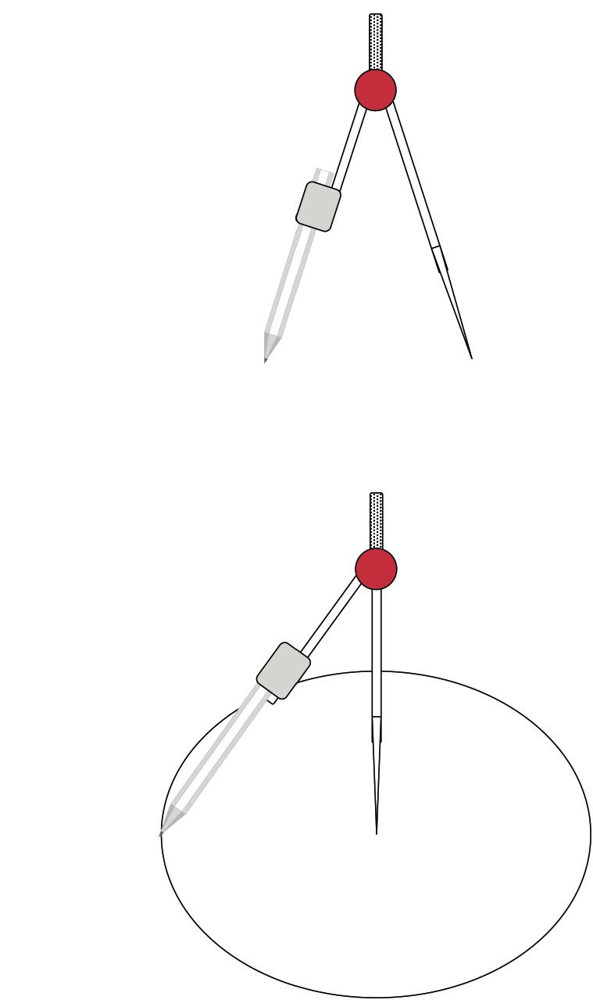

 **perpendicular lines**.What does it mean if we say
        'two lines are perpendicular'?

Use your protractor to
        measure the angles between the following pairs of lines. Then
        state whether they are perpendicular or not.

2. 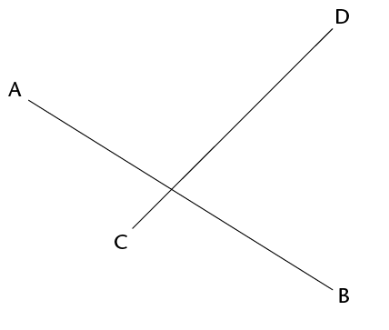
4. 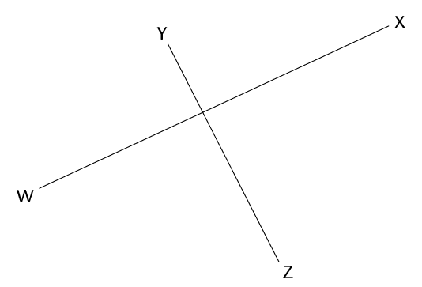

Do the following in your
        exercise book:

2. Use a compass to draw two overlapping
               circles of different sizes.
4. Draw a line through the points where the
               circles intersect (overlap).
6. Draw a line to join the centres of the
               circles.
   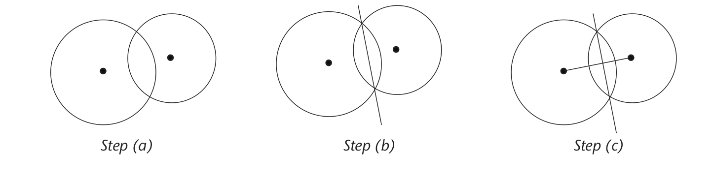
8. Use your protractor to
               measure the angles between the intersecting lines.
10. What can you say
               about the intersecting lines?

 Repeat questions 1(a) to (e)
        with circles that are the same size.
 What conclusion can
        you make about a line drawn between the intersection points of
        two overlapping circles and a line through their centres?

You are given line
              segment MN with point P at a distance from it. You must
              construct a line that is perpendicular to MN, so that
              the perpendicular passes through point P.

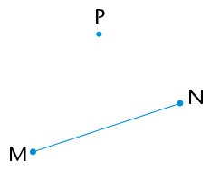

**Step 1**

Use your compass to draw
              a circle whose centre is the one end point of the line
              segment (N) and passes through the point (P).

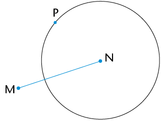

**Step 2**

Repeat step 1, but make
              the centre of your circle the other end point of the
              line segment (M).

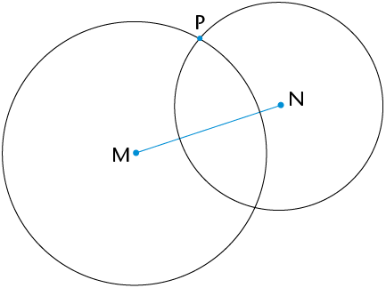

**Step 3**

Join the points where the
              circles intersect: PQ \(\perp \) MN

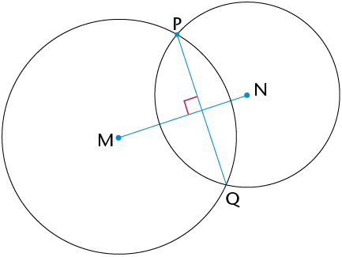

You are given line
              segment XY with point Z on it. You must construct a
              perpendicular line passing through Z.

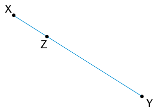

**Step 1**

Use your compass to draw
              a circle whose centre is Z. Make its radius smaller
              than ZX. Note the two points where the circle
              intersects XY.

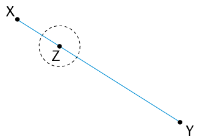

**Step 2**

Set your compass wider
              than it was for the circle with centre Z. Draw two
              circles of the same size whose centres are at the
                two pointswhere the first (black) circle
              intersects XY. The two circles (green) will
              overlap.

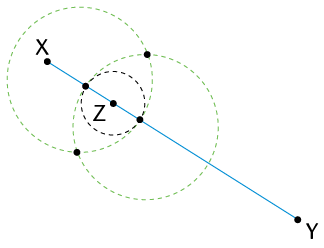

**Step 3**

Join the intersection
              points of the two overlapping circles. Mark these
              points C and D: CD \( \perp \) XY
              and passes through point Z.

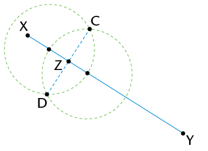

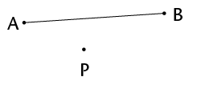

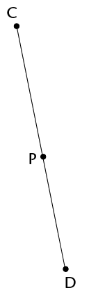

**bisect** an angle. Do the steps yourself in your exercise
      book.

The word **bisect** means
        'to cut in half'.

You are given \(\text{A}\hat{\text{B}}\text{C}\). You must bisect the
              angle.

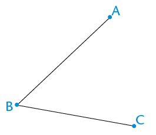

**Step 1**

Draw a circle with centre
              B to mark off an equal length on both arms of the
              angle. Label the points of intersection D and E: DB =
              BE.

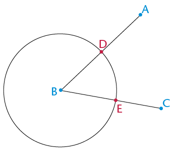

**Step 2**

Draw two equal circles
              with centres at D and at E. Make sure the circles
              overlap.

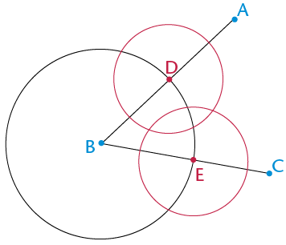

**Step 3**

Draw a line from B
              through the points where the two equal circles
              intersect. This line will bisect the angle.

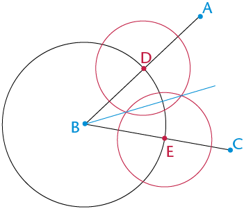

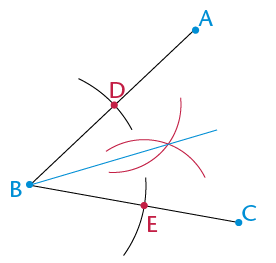

Same construction as
        in step 3 above

<Callout type="note" title="Note">
Can you explain why the
          method above works to bisect an angle?
</Callout>

<Callout type="note" title="Note">
Can you also see that we need
          not draw full circles, but can merely use parts of circles
          (arcs) to do the above construction?
</Callout>

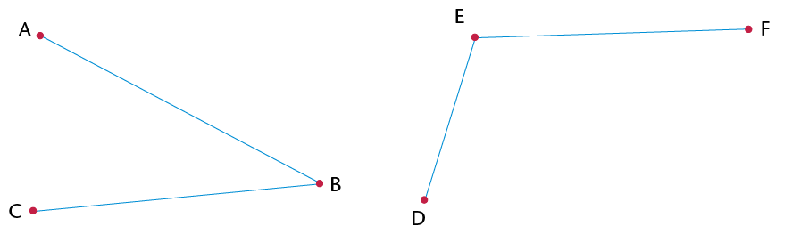

**special angles**. You must be able to construct these
      angles without using a protractor.

Hint: Extend the line to the
        left of X.

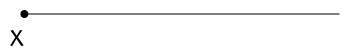

 What do you know about the
        sides and angles in an equilateral triangle?

In your exercise book, draw
        two circles with the following properties:

- The
              circles are the same size.
- Each
              circle passes through the other circle's centre.
- The
              centres of the circles are labelled A and B.
- The points
              of intersection of the circles are labelled D and E.

An example is shown here:

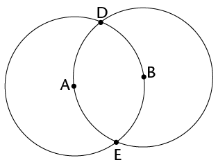

Draw in the following line
        segments: AB, AD and DB.
What can you say about the
        lengths of AB, AD and DB?

What kind of triangle
        is ABD?

Therefore, what do you know
        about \(\hat{A}, \hat{B} \text{ and } \hat{D}\)?

Use your knowledge of
        bisecting angles to create an angle of 30\(^\circ\) on the
        construction you made in question 2.
Use what you have
        learnt above to construct an angle of 60\(^\circ\) at point P
        on the following line segment:

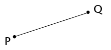

 Complete the table below. The
        first one has been done for you:

| Angle | Multiples below
                  360\(^\circ\) | Angle | Multiples below
                  360\(^\circ\) |
| --- | --- | --- | --- |
| 30\(^\circ\) | 30\(^\circ\);
                  60\(^\circ\); 90\(^\circ\); 120\(^\circ\);
                  150\(^\circ\); 180\(^\circ\); 210\(^\circ\);
                  240\(^\circ\); 270\(^\circ\); 300\(^\circ\);
                  330\(^\circ\) | 45\(^\circ\) |  |
| 60\(^\circ\) |  | 90\(^\circ\) |  |

In your exercise book,
        construct the following angles without using a protractor. You
        will need to do more than one construction to create each angle.

2. 120\(^\circ\)
4. 135\(^\circ\)
6. 270\(^\circ\)
8. 240\(^\circ\)
10. 150\(^\circ\)

**angle bisector** is a
      line that cuts an angle in half.

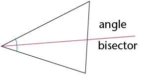

2. Bisect each of the angles of the
               acute triangle below.
4. Extend each of the bisectors to the
               opposite side of the triangle.
6. What do you notice?

Do the same with the obtuse
        triangle. What do you notice?

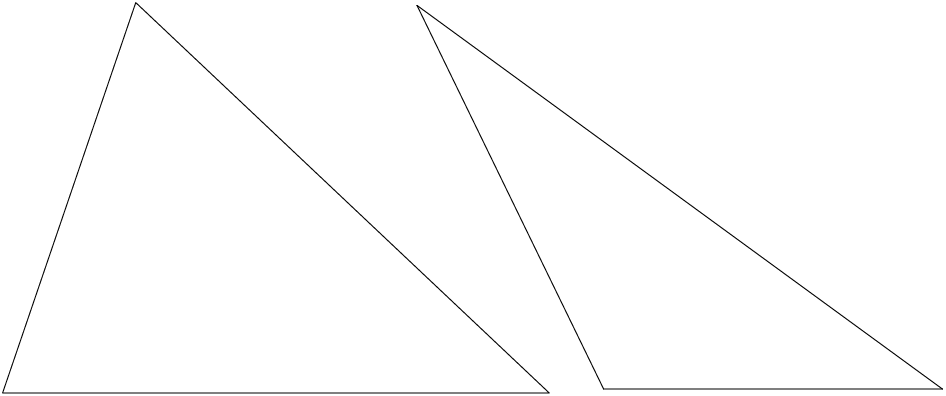

Compare your triangles
        with those of two classmates. You should have the same
        results.

You should have found that
        the three **angle bisectors** of a triangle **intersect
          at one point**. This point is the same distance away from
        each side of the triangle.

An **interior angle** is
        an angle that lies between two sides of a triangle. It is
        inside the triangle. A triangle has three interior
        angles.

An **exterior angle** is
        an angle between a side of a triangle and another side that
        is extended. It is outside the triangle.

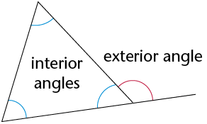

**interior
        opposite angles**, as described in the following table.

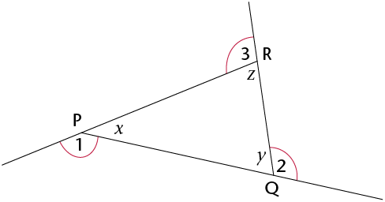

Exterior angle

Interior adjacent
              angle

Interior opposite
              angles

1

*x*

*z* and *y*

2

*y*

*x* and *z*

3

*z*

*x* and *y*

Name each exterior angle and
        its two interior opposite angles below.

2. 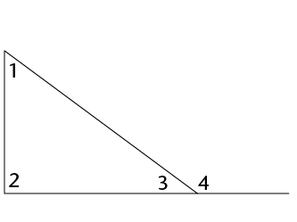
4. 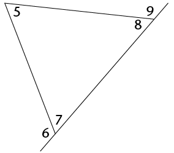
6. 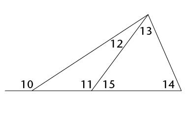

| Ext. \(\angle\) |  |  |  |  |  |
| --- | --- | --- | --- | --- | --- |
| Int. opp. \(\angle\)s |  |  |  |  |  |

\(\triangle\)ABC below has each
        side extended in both directions to create six exterior
        angles.

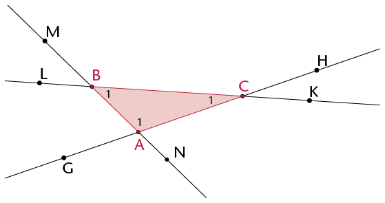

2. Write down the names of the interior
               angles of the triangle.
4. Since a triangle has three sides that
               can be extended in both directions, there are two exterior
               angles at each vertex. Write down the names of all the exterior
               angles of the triangle.
6. Explain why
                 \(\text{M}\hat{\text{B}}\text{L}\) is not an exterior angle of
                 \(\triangle\)ABC.
8. Write down two other angles that are
               neither interior nor exterior.

Consider \(\triangle\)LMN. Write
        down the name of the exterior angle.

Use a protractor to
        measure the interior angles and the exterior angle. Write the
        measurements on the drawing.

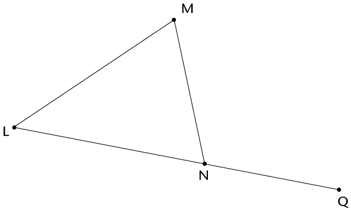

Use your findings in
        question 2 to complete this sum:

\(\text{L}\hat{\text{M}}\text{N} + \text{M}\hat{\text{L}}\text{N}
          = \)

What is the
        relationship between the exterior angle of a triangle and the
        sum of the interior opposite angles?

<Callout type="note" title="Note">
The **exterior angle**
            of a triangle is equal to the sum of the interior opposite
            angles.
</Callout>

Work out the sizes of
        angles *a* to *f* below, without using a protractor.
        Give reasons for the statements you make as you work out the
        answers.

2. 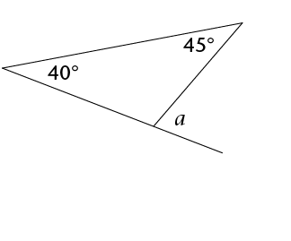
4. 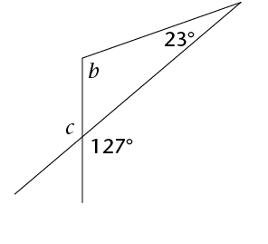
6. 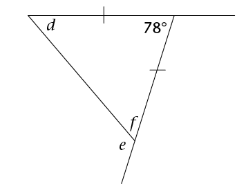

**congruent** if
      they have exactly the **same shape and size**: they are able
      to fit exactly on top of each other. This means that all three
      corresponding sides and three corresponding angles are equal,
      as shown in the following two pairs.

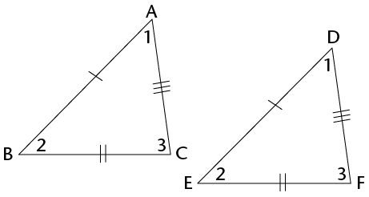

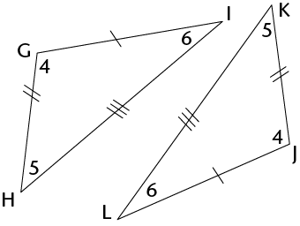

Use a ruler, compass
        and protractor to construct the following triangles. Each time
        minimum measurements are given.

2. Given three sides: side, side, side
               (SSS):\(\triangle\)DEF
               with DE = 7 cm, DF = 6 cm and EF = 5 cm.
4. Given three angles: angle, angle, angle
               (AAA):
               \(\triangle\)ABC with \(\hat{\text{A}} = 80^\circ, \hat{\text{B}} = 60^\circ, \hat{\text{C}} = 40^\circ\)
6. Given one side and two angles: side,
               angle, angle (SAA):
               \(\triangle\)GHI with \(\text{GH} = 8 \text{ cm}\), \(\hat{\text{G}} = 60^\circ, \hat{\text{H}} = 30^\circ\)
8. Given two sides and an included angle:
               side, angle, side (SAS): \(\triangle\)JKL with JK =9 cm, \(\hat{\text{K}}=\) 130\(^\circ\) and KL = 7 cm.
10. Given two sides and an angle that is not
               included: side, side, angle (SSA):\(\triangle\)MNP with MN = 10 cm,
               \(\hat{\text{M}}=\) = 50\(^\circ\) and PN = 8 cm.
12. Given a right angle, the hypotenuse and
               a side (RHS):\(\triangle\)TRS
               with TR \(\perp\) RS, RS = 7 cm
               and TS = 8 cm.
14. Triangle UVW with UV = 6 cm and VW = 4
               cm.

Compare your triangles
        with those of three classmates. Which of your triangles are
        congruent to theirs? Which are not congruent?

Go back to
        \(\triangle\)MNP (1e). Did you find that you can draw two different triangles
        that both meet the given measurements? One of the triangles
        will be obtuse and the other acute. Follow the construction
        steps below to see why this is so.

| Step 1 Construct MN = 10 cm and
                  the 50\(^\circ\) angle at M, even though you do not
                  know the length of unknown side (MP). | Step 2 \(\hat{N}\) is unknown, but NP = 8 cm. So
                  construct an arc 8 cm from N. Every point on the arc is
                  8 cm from N. |
| --- | --- |
| Step 3 Point P must be 8 cm from
                  N and fall on the unknown side of the triangle. The arc
                  intersects the third side at two points, so P can be at
                  either point. So two triangles are
                  possible, each meeting the conditions given, i.e. MN =
                  10 cm, NP = 8 cm and \(\hat{M}\) = 50\(^\circ\). |

4. Complete the table.
        Write down whether we can construct a congruent triangle when
        the following conditions are given.

| Conditions | Congruent? |
| --- | --- |
| 3 sides (SSS) |  |
| 2 sides (SS) |  |
| 3 angles (AAA) |  |
| 2 angles and a side
                  (AAS) |  |
| 2 sides and an angle not
                  between the sides (SSA) |  |
| 2 sides and an angle between
                  the sides (SAS) |  |
| Right-angled with the
                  hypotenuse and a side (RHS) |  |

**diagonal** is a straight line
      inside a figure that joins two vertices of the figure, where
      the vertices are not next to each other.Look at the
        quadrilaterals below. The two diagonals of the square have been
        drawn in: AC and BD.
Draw in the diagonals of the
        other quadrilaterals below.

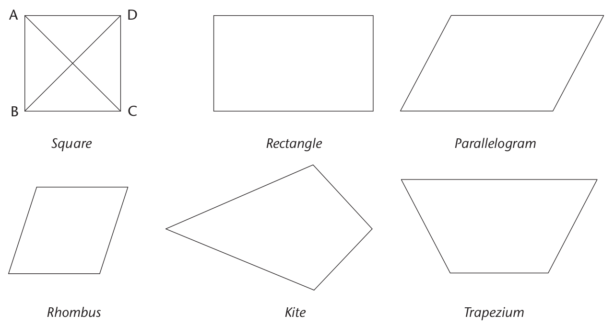

How many sides does a
        quadrilateral have?

How many angles does a
        quadrilateral have?

How many diagonals does
        a quadrilateral have?

Construct a rhombus
        inside the circles by joining the centre of each circle with
        the intersection points of the circles. Join AB.
Construct the
        perpendicular bisector of AB.(Go back to Section 10.1 if you
        need help.)What do you find?

A **perpendicular bisector**
        is a line that cuts another line in half at a right angle
        (90\(^\circ\)).

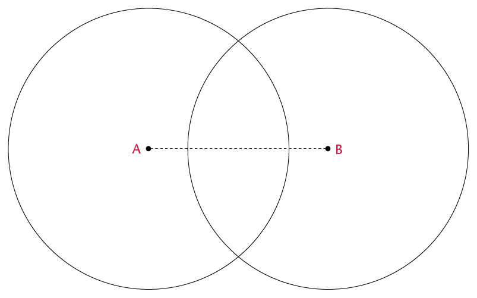

 Do the diagonals bisect
        each other?

Complete the sentence: The
        diagonals of a rhombus will always

Construct a kite by
        joining the centre points of the circles to the intersection
        points of the circles.
Draw in the diagonals of the
        kite.
Mark all lines that
        are the same length.

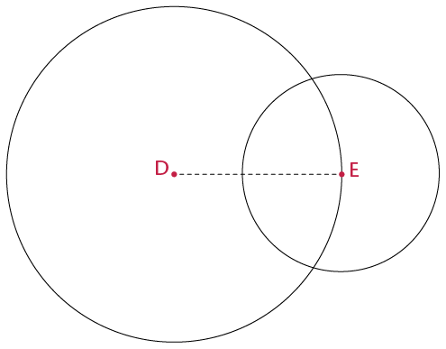

Are the diagonals of the kite
        perpendicular?

Do the diagonals of the kite
        bisect each other?

What is the difference between
        the diagonals of a rhombus and those of a kite?

Use the grid to draw a
        parallelogram, rectangle and square.

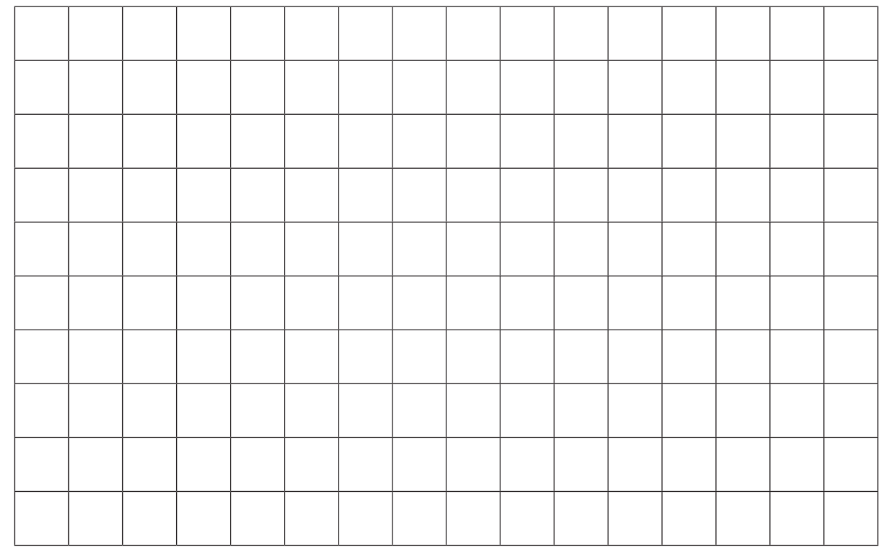

Draw in the diagonals of the
        quadrilaterals above.
Indicate on each shape all the
        lengths in the diagonals that are equal. (Use a ruler.)
Use the information you have
        found to complete the table below. Fill in
        'yes' or 'no'.

| Quadrilateral | Diagonals equal | Diagonals bisect | Diagonals meet at
                  90\(^\circ\) |
| --- | --- | --- | --- |
| Parallelogram |  |  |  |
| Rectangle |  |  |  |
| Square |  |  |  |

We can divide a quadrilateral
        into two triangles by drawing in one diagonal.

2. Draw in diagonals to divide each of the
               other polygons below into as few triangles as possible.
4. Write down the number of triangles in
               each polygon.

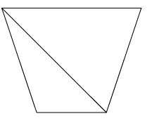

Quadrilateral

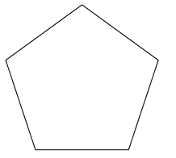

Pentagon

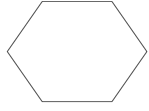

Hexagon

No. of \(\triangle\)s

2

Sum of \(\angle\)s

2 \times 180\(^\circ\)
              = 360\(^\circ\)

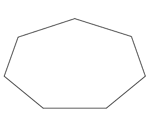

Heptagon

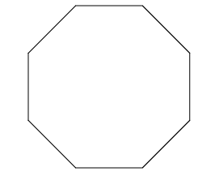

Octagon

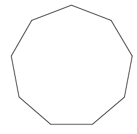

Nonagon

No. of \(\triangle\)s

Sum of \(\angle\)s

The sum of the angles
        of one triangle is 180\(^\circ\). A quadrilateral is made up
        of two triangles, so the sum of the angles in a quadrilateral is
        \(2 \times 180^\circ = 360^\circ\). Work out the sum of
        the interior angles of each of the other polygons above.

2. Match the words in the column on
             the right with the definitions on the left. Write the letter of
             the definition next to the matching word.
   | (a) A quadrilateral
                       that has diagonals that are perpendicular and they
                       bisect each other | Kite |
   | --- | --- |
   | (b) A quadrilateral
                       that has diagonals that are perpendicular to each
                       other, and only one diagonal bisects the other | Congruent |
   | (c) A quadrilateral
                       that has equal diagonals that bisect each other | Exterior angle |
   | (d) Figures that
                       have exactly the same size and shape | Rhombus |
   | (e) Divides into two
                       equal parts | Perpendicular |
   | (f) An angle
                         that is formed outside a closed shape: it is
                         between the side of the shape and a side that
                       has been extended | Bisect |
   | (g) Lines that
                       intersect at 90 degrees | Special angles |
   | (h) 90\(^\circ\),
                       45\(^\circ\), 30\(^\circ\), 60\(^\circ\) | Rectangle |
4. Complete
             the sentence: The exterior angle in a triangle is equal to
6. 2. Construct \(\triangle\)PQR below
                    with angles of 30\(^\circ\) and 60\(^\circ\). The side
                    between the angles must be 8 cm. You may use only a ruler and a
                    compass.
   4. Will all triangles with the same measurements above be congruent to
                    \(\triangle\)PQR? Explain
                    your answer.
