# Chapter 12: Geometry of 2d shapes

Use a protractor to
        measure the interior angles of each of the following triangles.
        Write the sizes of the angles on the diagrams.

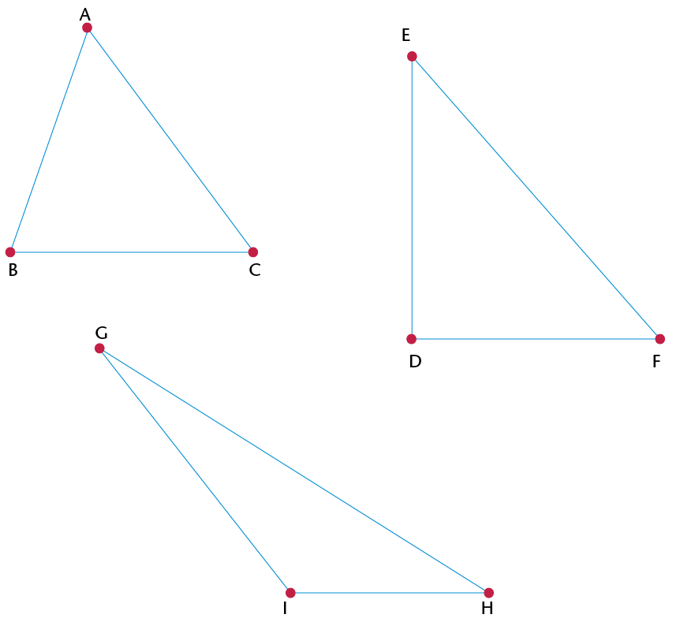

        Classify the triangles in question 1 according to their angle
        properties. Choose from the following types of triangles:
        acute-angled, obtuse-angled and right-angled.

2. \(\triangle\)ABC is an
               _______
               triangle, because
4. \(\triangle\)EDF is a
               _______ triangle, because
6. \(\triangle\)GHI is an
               obtuse-angled triangle, because

        The marked angles in each triangle below are equal. Classify
        the triangles according to angle and side properties.

2. \(\triangle\) .......... is an acute isosceles triangle, because ........ and .........
4. \(\triangle\) .......... is a right-angled isosceles triangle, because ......... and ........
6. \(\triangle\) .......... is an obtuse isosceles triangle, because ........... and ..........

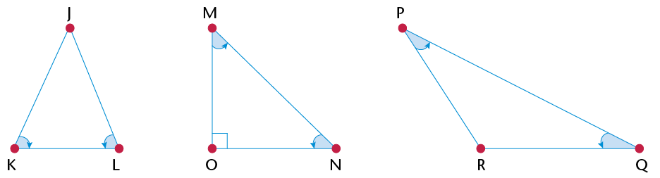

Say for what kind of
        triangle each statement is true. If it is true for all
        triangles, then write 'All triangles'.

|  | Statement | True for |
| --- | --- | --- |
| (a) | Two sides of the triangle are
                  equal. |  |
| (b) | One angle of the triangle is
                  obtuse. |  |
| (c) | Two angles of the triangle
                  are equal. |  |
| (d) | All three angles of the
                  triangle are equal to 60\(^\circ\). |  |
| (e) | The size of an exterior angle
                  is equal to the sum of the opposite interior
                  angles. |  |
| (f) | The longest side of the
                  triangle is opposite the biggest angle. |  |
| (g) | The sum of the two shorter
                  sides of the triangle is bigger than the length of the
                  longest side. |  |
| (h) | The square of the length of
                  one side is equal to the sum of the squares of the
                  other sides. |  |
| (i) | The square of the length of
                  one side is bigger than the sum of the squares of the
                  other sides. |  |
| (j) | The sum of the interior
                  angles of the triangle is 180\(^\circ\). |  |

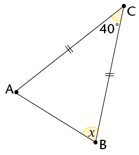

Statement
Reason

\(\text{AC} = \text{BC} \)
Given

\(\therefore\hat{\text{A}} = \hat{\text{B}}\)

\(180^\circ = 40^\circ + x + x \)
Sum \(\angle\)s
            \(\triangle\)

\(180^\circ = 40^\circ + 2x \)

\(\therefore x = \)

Calculate the sizes of the
        unknown angles.

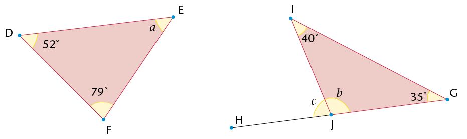

Determine the sizes of the
        unknown angles and the length of MO.

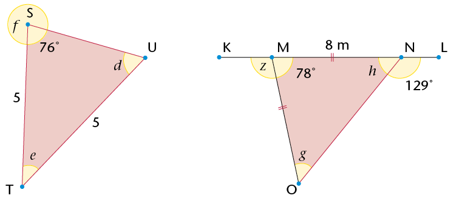

Calculate the sizes of
        *y* and *x*.

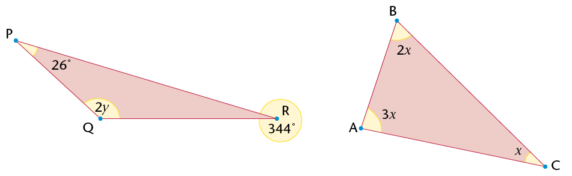

Name the following
        quadrilaterals. Mark equal angles and equal sides in each
        figure. Use your ruler and protractor to measure angle sizes
        and lengths where necessary.

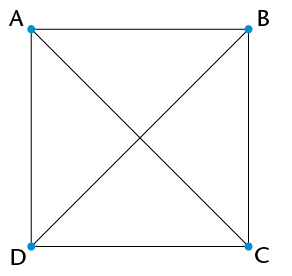

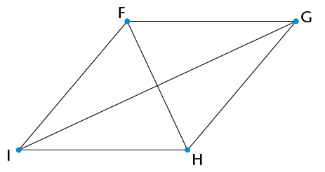

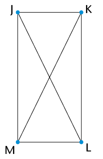

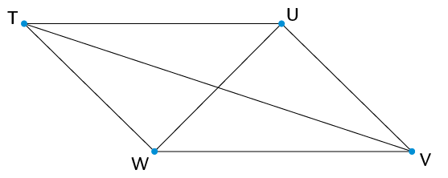

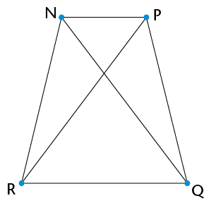

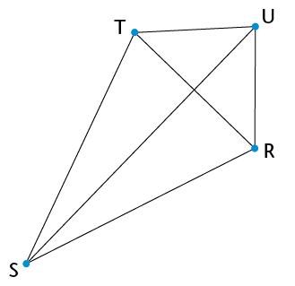

Complete the following
        table:

| Properties | True for the following
                  quadrilaterals |
| --- | --- |
| Square | Rhombus | Rectangle | Parallelogram | Kite | Trapezium |
| At least one pair of
                  opposite angles is equal. | yes | yes | yes | yes | yes | no |
| Both pairs of opposite
                  angles are equal. |  |  |  |  |  |  |
| At least one pair of
                  adjacent angles is equal. |  |  |  |  |  |  |
| All four angles are
                  equal. |  |  |  |  |  |  |
| Any two opposite sides are
                  equal. |  |  |  |  |  |  |
| Two adjacent sides are
                  equal, and the other two adjacent sides are also
                  equal. |  |  |  |  |  |  |
| All four sides are
                  equal. |  |  |  |  |  |  |
| At least one pair of
                  opposite sides is parallel. |  |  |  |  |  |  |
| Any two opposite sides are
                  parallel. |  |  |  |  |  |  |
| The two diagonals are
                  perpendicular. |  |  |  |  |  |  |
| At least one diagonal
                  bisects the other one. |  |  |  |  |  |  |
| The two diagonals bisect
                  each other. |  |  |  |  |  |  |
| The two diagonals are
                  equal. |  |  |  |  |  |  |
| At least one diagonal
                  bisects a pair of opposite angles. |  |  |  |  |  |  |
| Both diagonals bisect a pair
                  of opposite angles. |  |  |  |  |  |  |
| The sum of the interior
                  angles is 360\(^\circ\). |  |  |  |  |  |  |

Look at the properties of a
        square and a rhombus.

2. Are all the properties of a square also
               the properties of a rhombus? Explain.
4. Are all the properties of a rhombus also
               the properties of a square? Explain.
6. Which statement is
               true?
   A square is a special kind of
                 rhombus.
   A rhombus is a special kind of
                 square.

Look at the properties of a
        square and a rectangle.

2. Are all the properties of a square also
               the properties of a rectangle? Explain.
4. Are all the properties of a rectangle also
               the properties of a square? Explain.
6. Which statement is
               true?
   A square is a special kind of
                 rectangle.
   A rectangle is a special kind of
                 square.

Look at the properties of a
        parallelogram and a rectangle.

2. Are all the properties of a parallelogram also
               the properties of a rectangle? Explain.
4. Are all the properties of a rectangle also
               the properties of a parallelogram? Explain.
6. Which statement is
               true?
   A parallelogram is a special kind of
                 rectangle.
   A rectangle is a special kind of
                 parallelogram.

Look at the properties
        of a rhombus and a parallelogram. Is a rhombus a special kind
        of parallelogram? Explain.

Compare the properties
        of a kite and a parallelogram. Why is a kite not a special kind
        of parallelogram?

Compare the properties
        of a trapezium and a parallelogram. Why is a trapezium not a
        special kind of parallelogram?

Determine the sizes of
        angles *a* to *e* in the quadrilaterals below. Give
        reasons for your answers.

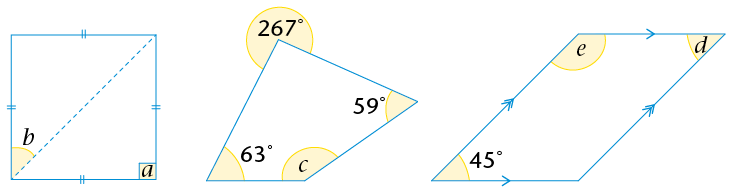

Calculate the
        perimeters of the quadrilaterals on the right. Give your
        answers to two decimal places.

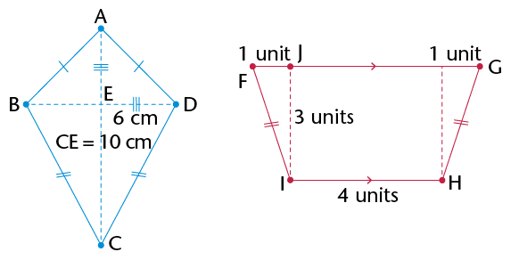

words, if you cut out one of the triangles and place it
        on the other, they will match exactly.

If you know that two
        triangles are congruent, then each side in the one triangle
        will be equal to each corresponding side in the second
        triangle. Also, each angle in the one triangle will be equal
        to each corresponding angle in the second triangle.

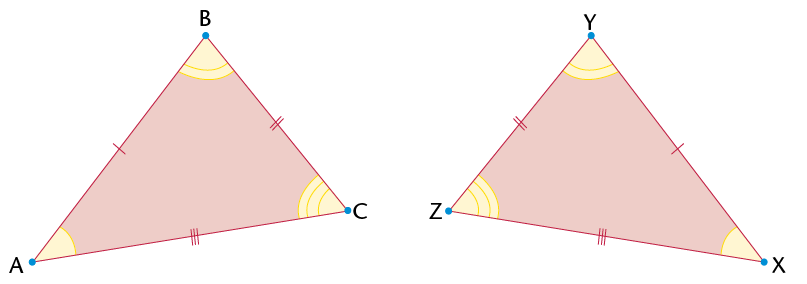

\(\equiv\)
      \(\triangle\)XYZ.

**Congruency symbol**

\(\equiv\) means
        'is congruent to'

\(\triangle\)KLM \(\equiv\)
        \(\triangle\)PQR:

\(\triangle\)FGH \(\equiv\)
        \(\triangle\)CST:

The conditions for
        congruency:

- SSS (all corresponding sides are equal)
- SAS (two corresponding sides and the angle between the two sides are equal)
- AAS (two corresponding angles and any corresponding side are equal)
- RHS (both triangles have a \(90^\circ\) angle and have equal hypotenuses and one other side equal)

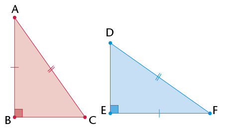

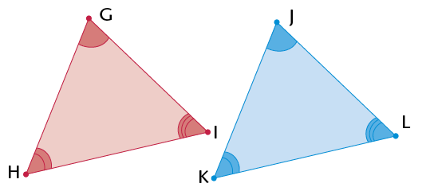

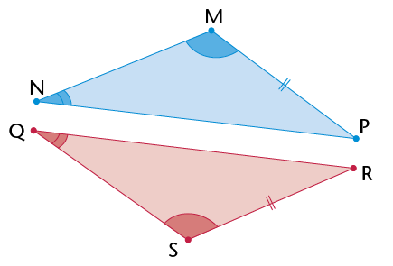

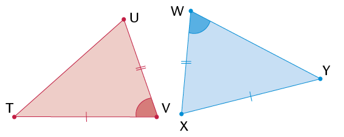

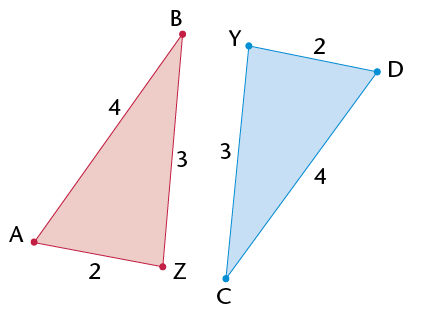

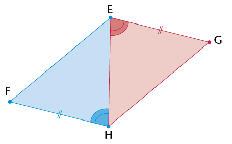

- Each
            statement you make needs a reason.
- You
            must give three statements to prove any two triangles
            congruent.
- Give
            the reason for congruency.

**Example:**

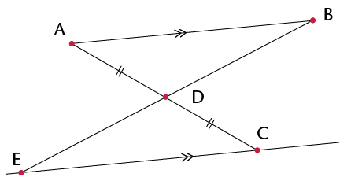

*Solution:*

Statement

Reason

In \(\triangle\)ABD and
              \(\triangle\)CED:

1) AD = DC

2) \(\text{A}\hat{\text{D}}\text{B} = \text{C}\hat{\text{D}}\text{E}\)

3) \(\text{B}\hat{\text{A}}\text{D} = \text{E}\hat{\text{C}}\text{D}\)

\(\therefore\)
              \(\triangle\)ABD \(\equiv\)
              \(\triangle\)CED

Given

Vert. opp. \(\angle\)s

Alt. \(\angle\)s
              (AB\(||\) EC)

AAS

Prove that \(\triangle\)ACE
        \(\equiv\)
        \(\triangle\)BDE.

|  | Statement | Reason |
| --- | --- | --- |

Prove that \(\triangle\)WXZ
        \(\equiv\)
        \(\triangle\)YXZ.

|  | Statement | Reason |
| --- | --- | --- |

Prove that QR = SP. (Hint:
        First prove that the triangles are congruent.)

|  | Statement | Reason |
| --- | --- | --- |

Prove that the triangles below
        are congruent. Then find the size of \(\text{Q}\hat{\text{M}}\text{P}\).

|  | Statement | Reason |
| --- | --- | --- |

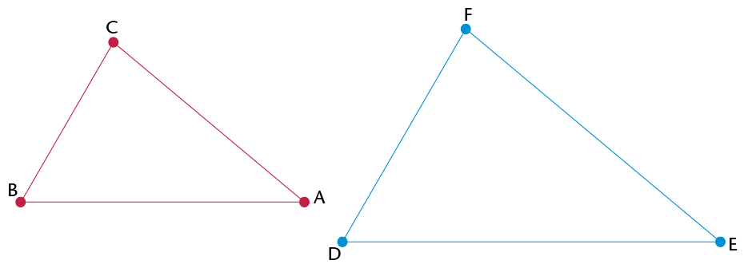

2. Use a
               protractor to measure the angles in each triangle above. Then
               complete the table below.
   | Angle | Angle | What do you notice? |
   | --- | --- | --- |
   | \(\hat{\text{B}} =\quad\) | \(\hat{\text{D}} =\) |  |
   | \(\hat{\text{A}} =\) | \(\hat{\text{E}} =\) |  |
   | \(\hat{\text{C}} =\) > | \(\hat{\text{F}} =\quad\) |  |
4. What can you say about the sizes of the
               angles in similar triangles?

2. Use a ruler to measure the lengths of
               the sides in each triangle in question 1. Then complete the
               table below.
   | Length (cm) | Length (cm) | Ratio |
   | --- | --- | --- |
   | BA = | DE = | BA : DE = \(\quad\) = \(1 : 1\frac{1}{3}\) |
   | BC = | DF = | BC : DF = \(\quad\) = \(\quad\) |
   | CA = | FE = | CA : FE = \(\quad\) = \(\quad\) |
4. What can you say about the relationship
               between the sides in similar triangles?

<Callout type="note" title="Note">
Ratio reminder

You read 2 : 1 as
            'two to one'.
</Callout>

2. The following notation
                 shows that the triangles are similar: \(\triangle\)BAC
                 \(|||\) \(\triangle\)DEF. Why do you think we write the
                 first triangle as \(\triangle\)BAC and not as \(\triangle\)ABC?
   <Callout type="note" title="Note">
   **The properties of
                     similar triangles:**
   - The corresponding angles are equal.
   - The corresponding sides are in proportion.
   </Callout>
   **Notation for similar
                   triangles:**
   <Callout type="note" title="Note">
   If \(\triangle\)XYZ is similar
                   to \(\triangle\)PQR, then we write: \(\triangle\)XYZ
                   \(|||\) \(\triangle\)PQR.
   Angles: \(\hat{\text{X}} = \hat{\text{P}}\) and \(\hat{\text{Y}} = \hat{\text{Q}}\) and \(\hat{\text{Z}} = \hat{\text{R}}\)
   Sides: \(\text{X}\)\(\text{Y}\):\(\text{P}\)\(\text{Q}=\text{X}\)\(\text{Z}\): \(\text{P}\)\(\text{R}=\text{Y}\)\(\text{Z}\):\(\text{Q}\)\(\text{R}\)
   </Callout>
   When proving that triangles are
                 similar, you either need to show that the corresponding angles
                 are equal or you must show that the sides are in
                 proportion.

Decide if the following
        triangles are similar to each other.

2. 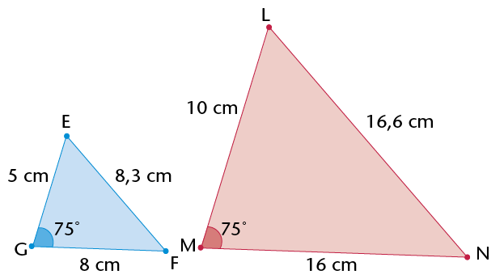
4. 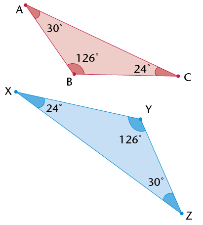
6. 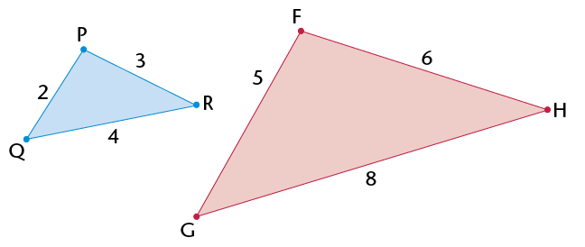
8. 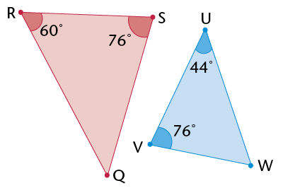

Do the following task in your
        exercise book.

- Use a
              ruler and protractor to construct the triangles described in
              (a) to (d) below.
- Use your
              knowledge of similarity to draw the second triangle in each
              question.
- Indicate
              the sizes of the corresponding sides and angles on the second
              triangle.

2. In \(\triangle\)EFG, \(\hat{\text{G}}\)= 75\(^\circ\), EG = 4 cm and GF = 5
               cm. \(\triangle\)ABC is an enlargement of \(\triangle\)EFG, with its
               sides three times longer.
4. In \(\triangle\)MNO,
               \(\hat{\text{M}}\)= 45\(^\circ\), \(\hat{\text{N}}\)= 30\(^\circ\) and MN = 5 cm.
               \(\triangle\)PQR is similar to \(\triangle\)MNO. The sides of
               \(\triangle\)MNO to \(\triangle\)PQR are in proportion 1 : 3.
6. \(\triangle\)RST is an
               isosceles triangle. \(\hat{\text{R}}\)= 40\(^\circ\), RS is 10 cm and RS =
               RT. \(\triangle\)VWX is similar to \(\triangle\)RST. The sides of
               \(\triangle\)RST to \(\triangle\)VWX are in proportion 1:\(\frac{1}{2}\).
8. \(\triangle\)KLM is right-angled at
               \(\hat{\text{L}}\), LM is 7 cm and the hypotenuse is 12 cm.
               \(\triangle\)XYZ is similar to \(\triangle\)KLM, so that the sides
               are a third of the length of \(\triangle\)KLM.

2. Which of the following
               are minimum conditions for similar triangles?
   2. Two angles in one
                    triangle are equal to two angles in another
                    triangle.
      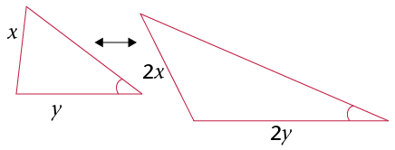
   4. Two sides of one
                    triangle are in the same proportion as two sides in
                    another triangle.
      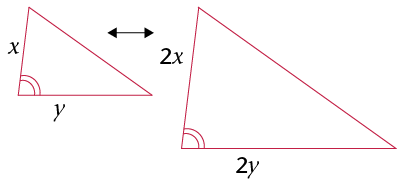
   6. Two sides of one
                    triangle are in the same proportion as two sides in
                    another triangle, and the angle between the two sides
                    is equal to the angle between the corresponding
                    sides.
      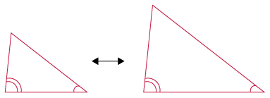
   8. Two sides of one
                    triangle are in the same proportion as two sides in
                    another triangle, and one angle not between the two
                    sides is equal to the corresponding angle in the other
                    triangle.
      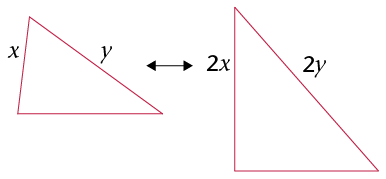

**Parallel lines** never
        meet. Two lines are parallel to each other if the distance
        between them is the same along the whole length of the
        lines.

Line segment QR is parallel to
        line segment ST.

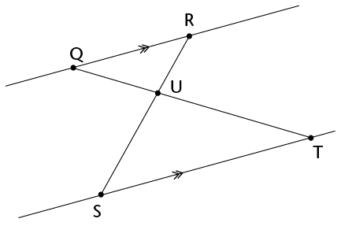

Complete the following proof that
          \(\triangle\)QRU \(|||\) \(\triangle\)TSU:

| Statement | Reason |
| --- | --- |
| \(\text{R}\)\(\hat{\text{Q}}\)\(\text{T}\) = \(\text{Q}\)\(\hat{\text{T}}\)\(\text{S}\) \(\text{Q}\)\(\hat{\text{R}}\)\(\text{S}\)= = \(\therefore\)\(\triangle\)QRU\(|||\) \(\triangle\)TSU | Alt. \(\angle\) s Vert. opp. \(\angle\) s Equal \(\angle\) s (or
                  AAA) |

The following intersecting
        line segments form triangle pairs between parallel lines.

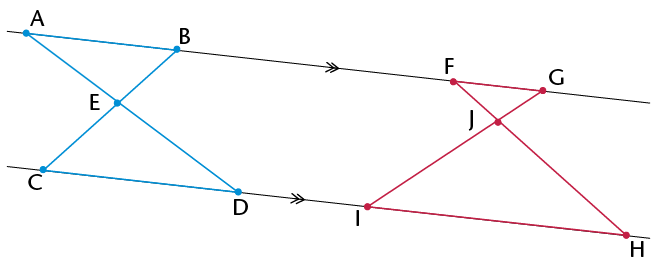

2. Are the triangles in each pair similar?
               Explain.
4. Write down pairs of
               similar triangles.
6. Are triangles like these always similar?
               Explain how you can be sure without measuring every possible
               triangle pair.

The intersecting lines on the right form triangle pairs between
        the line segments that are not parallel. Are these triangle
        pairs similar? Explain why or why not.

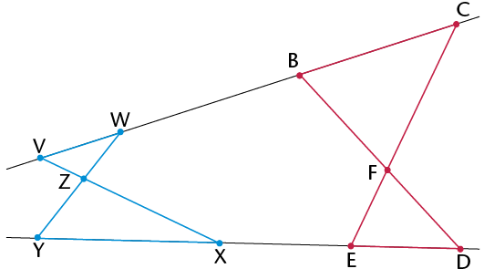

Consider
        the triangles below. DE\(||\) BC. Prove that
        \(\triangle\)ABC\(|||\) \(\triangle\)ADE.

|  | Statement | Reason |
| --- | --- | --- |

 In the diagram on the
        right, ST is a telephone pole and UV is a vertical stick. The
        stick is 1 m high and it casts a shadow of 1,7 m (VW). The
        telephone pole casts a shadow of 5,1 m (TW). Use similar
        triangles to calculate the height of the telephone pole.

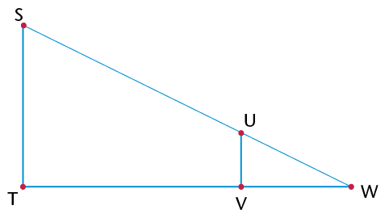

 How many similar triangles are
        there in the diagram below? Explain your answer.

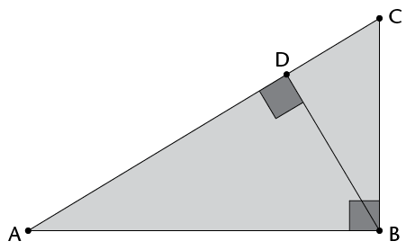

\(\triangle\)ABC on the
        right is equilateral. D is the midpoint of AB, E is the
        midpoint of BCand F is the midpoint of AC.

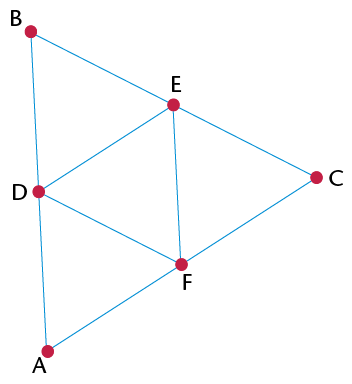

2. Prove that \(\triangle\)BDE is an
               equilateral triangle.
4. Find all the congruent triangles. Give a
               proof for each.
6. Name as many similar triangles as you
               can. Explain how you know they are similar.
8. What is the proportion of the
               corresponding sides of the similar triangles?
10. Prove that DE is parallel to AC.
12. Is DF parallel to BC? Is EF parallel to
               BA? Explain.

Consider the similar
        triangles drawn below using concentric circles. Explain why the
        triangles are similar in each diagram.

2. 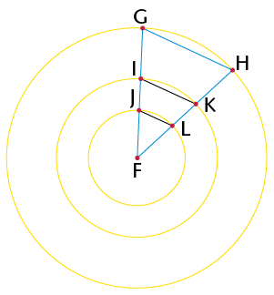
4. 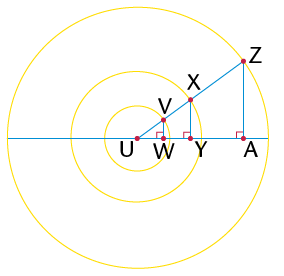
