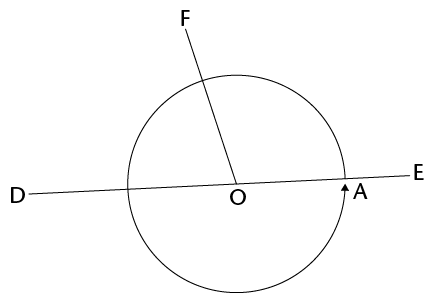
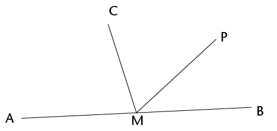
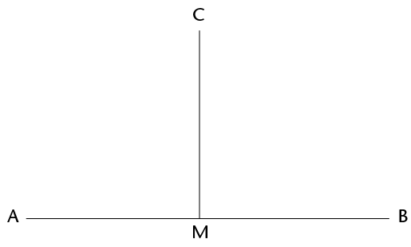
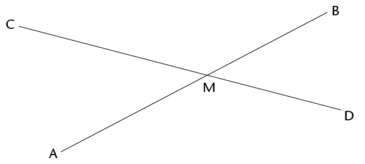
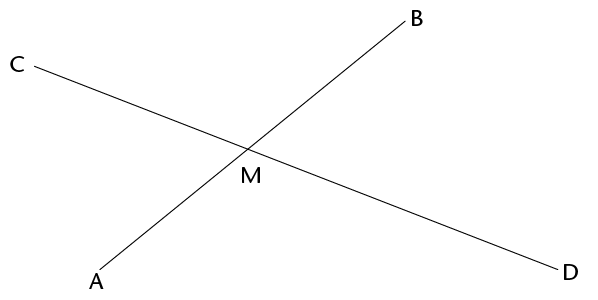
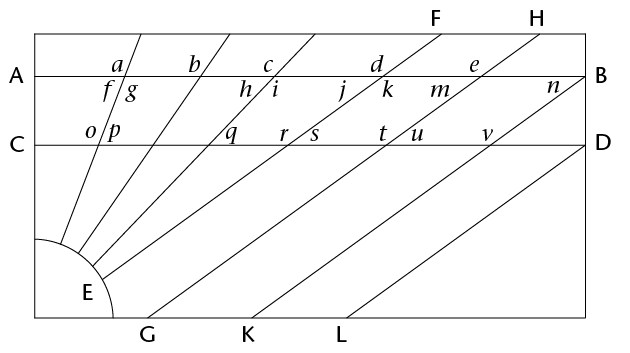
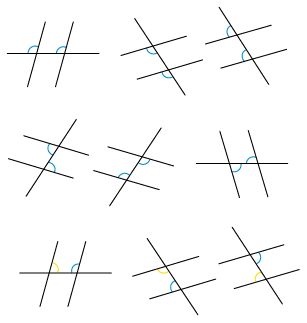
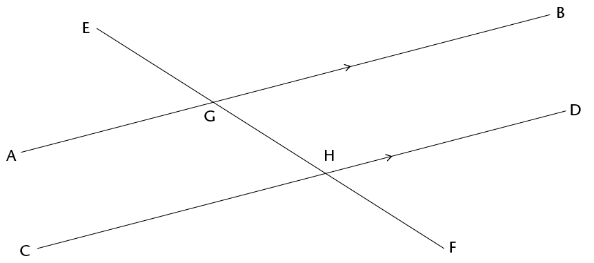
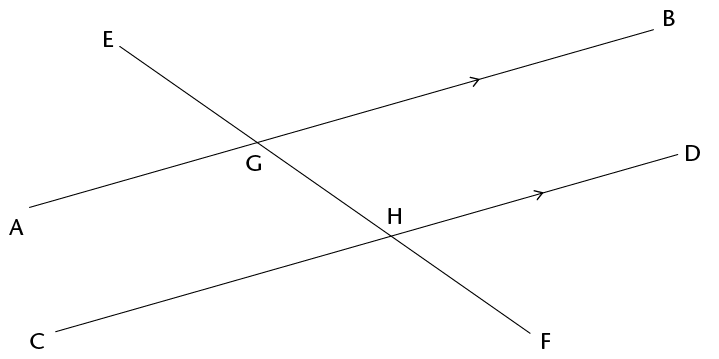
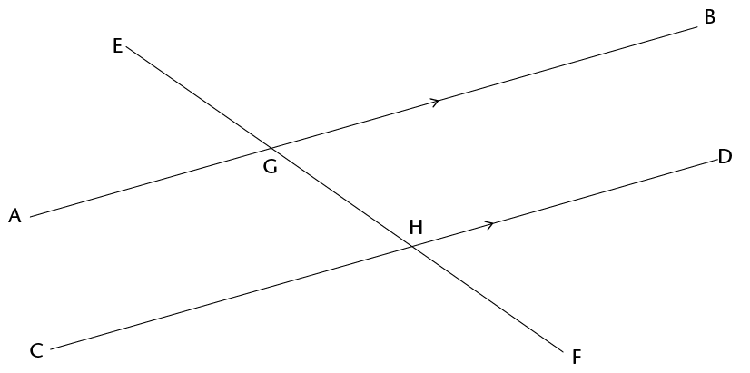

## Angle relationships

Remember that 360\(^\circ\) is one
        full revolution.

If you look at something and then turn all the
        way around so that you are looking at it again, you have turned
        through an angle of 360\(^\circ\). If you turn only halfway
        around, so that you look at something that was right behind
        your back, you have turned through an angle of
        180\(^\circ\).

2. Answer the questions about the
             figure below.
   
   2. Is angle \(\hat{FOD}\) in the figure smaller or
                    bigger than a right angle?
   4. Is angle \(\hat{FOE}\) in the above figure smaller
                    or bigger than a right angle?
   On the figure above, \(\text{F}\)\(\hat{\text{O}}\)\(\text{D}\) + \(\text{F}\)\(\hat{\text{O}}\)\(\text{C}\)= half of a revolution =
               180\(^\circ\).
   <Callout type="note" title="Note">
   The sum of the angles on a
                 straight line is 180\(^\circ\).
   When the sum of angles is
                 180\(^\circ\), the angles are called
                 **supplementary**.
   </Callout>
4. \(\text{C}\)\(\hat{\text{M}}\)\(\text{A}\)in the figure below is 75\(^\circ\).
             AMB is a straight line.
   
   2. How big is
                    \(\text{C}\)\(\hat{\text{M}}\)\(\text{B}\)?
   4. Why do you say so?
6. \(\text{P}\)\(\hat{\text{M}}\)\(\text{B}\) in the figure in question 2 is
             40\(^\circ\).
   2. How big is
                    \(\text{C}\)\(\hat{\text{M}}\)\(\text{P}\)?
   4. Explain your reasoning.
8. In the figure below,
               AMB is a straight line and \(\text{A}\)\(\hat{\text{M}}\)\(\text{C}\) and \(\text{B}\)\(\hat{\text{M}}\)\(\text{C}\) are equal angles.
   2. How big are these
                    angles?
   4. How do you know this?
   
   <Callout type="note" title="Note">
   When one line forms two
                 equal angles where it meets another line, the two lines are
                 said to be **perpendicular**.
   Because the two equal angles are angles
                 on a
                 straight line, their sum is 180°, hence each angle
                 is 90°.
   </Callout>
10. In the figure below, lines AB
             and CD intersect at point M.
   
   <Callout type="note" title="Note">
   In this chapter, you
                 are required to give good reasons for every statement you
                 make.
   </Callout>
   2. Does it look as if \(\text{C}\)\(\hat{\text{M}}\)\(\text{A}\) and \(\text{B}\)\(\hat{\text{M}}\)\(\text{D}\) are equal?
   4. Can you explain why they are equal?
   6. What does \(\text{C}\)\(\hat{\text{M}}\)\(\text{A}\) +
                    \(\text{D}\)\(\hat{\text{M}}\)\(\text{A}\) equal?
      Why do you say so?
   8. What is \(\text{C}\)\(\hat{\text{M}}\)\(\text{A}\) +
                    \(\text{C}\)\(\hat{\text{M}}\)\(\text{B}\)?
      Why do you say so?
   10. Is
                    it true that \(\text{C}\)\(\hat{\text{M}}\)\(\text{A}\) +
                    \(\text{D}\)\(\hat{\text{M}}\)\(\text{A}\) =
                    \(\text{C}\)\(\hat{\text{M}}\)\(\text{A}\) +
                    \(\text{C}\)\(\hat{\text{M}}\)\(\text{B}\)
   12. Which angle occurs on both
                    sides of the equation in (e)?
12. Look carefully at your
             answers to questions 5(c) to 5(e).
   Now try to explain your
               observation in question 5(a).
14. In the figure below,
             AB and CD intersect in M. Four angles are formed. Angle CMB and
             angle AMD are called **vertically opposite** angles. Angle
             CMA and angle BMD are also **vertically opposite**.
   <Callout type="note" title="Note">
   When two straight lines
                 intersect, the vertically opposite angles are equal.
   </Callout>
   
   2. If angle BMC =
                    125\(^\circ\), how big is angle AMD?
   4. Why do say so?

### Lines and angles

<Callout type="note" title="Note">
A line that intersects other
          lines is called a **transversal**.
</Callout>

In the above pattern, AB is
        parallel to CD and EF \(||\) GH \(||\) KB
        \(||\) LD.

2. Angles *a*, *b*, *c*, *d* and *e* are **corresponding angles**. Do the
             corresponding angles look appear to be equal?
4. Investigate whether
             the corresponding angles are equal by using tracing paper.
             Trace the angle you want to compare to other angles and place
             it on top of the other angle to find out if they are equal.
             What do you notice?
6. Angles *f*, *h*, *j*, *m* and *n* are also corresponding angles.
             Identify all the other groups of corresponding angles in the
             pattern.
8. Describe the position
             of corresponding angles that are formed when a transversal
             intersects other lines.
10. The following are
             pairs of **alternate angles**: *g* and *o*;
             *j* and *s*; and *k* and *r*.
   Do these angles appear to
               be equal?
12. Investigate whether
             the alternate angles are equal by using tracing paper. Trace
             the angle you want to compare and place it on top of the other
             angle to find out if they are equal. What do you notice?
14. Identify two more pairs of
             alternate angles.
16. Clearly describe the
             relative position of alternate angles that are formed when a
             transversal intersects other lines.
18. Did you notice
             something about some of the pairs of corresponding angles when
             you did the investigation in question 6? Describe your
             finding.
20. Angles *f* and *o*; *i* and *q* and *k* and *s* are all pairs of
             **co-interior angles**. Identify three more pairs of
             co-interior angles in the pattern.

<Callout type="note" title="Note">

The angles in the same
          relative position at each intersection where a straight line
          crosses two others are called **corresponding
            angles**.

Angles on different sides of a
          transversal and
          between two other lines are called **alternate angles**.
          .

Angles on the same side of the
          transversal and
          between two other lines are called **co-interior
            angles**.
          .
</Callout>

### Angles formed by parallel lines

#### Corresponding angles

The lines AB and CD below never meet.
        Lines that never meet and are at a fixed distance from one
        another are called parallel lines. We write AB \(||\)
        CD.

<Callout type="note" title="Note">
Parallel lines have the
          same direction, i.e. they form **equal corresponding
            angles** with any line that intersects them.
</Callout>

The line EF cuts AB at G and CD at
        H.

EF is a transversal that cuts
        parallel lines AB and CD.

2. 2. Look carefully at the angles EGA and
                    EHC in the above figure. They are called **corresponding angles**.
                    Do they appear to be equal?
   4. Measure the two angles to check whether
                    they are equal. What do you notice?
4. Suppose \(\text{E}\)\(\hat{\text{G}}\)\(\text{A}\) and \(\text{E}\)\(\hat{\text{H}}\)\(\text{C}\) are really equal. Would \(\text{E}\)\(\hat{\text{G}}\)\(\text{B}\) and \(\text{E}\)\(\hat{\text{H}}\)\(\text{D}\) then also be equal? Give reasons to
             support your answer.
   <Callout type="note" title="Note">
   When two parallel lines are
                 cut by a transversal, the corresponding angles are equal.
   </Callout>

#### Alternate angles

The angles \(\text{B}\)\(\hat{\text{G}}\)\(\text{F}\) and \(\text{C}\)\(\hat{\text{H}}\)\(\text{E}\) below are called **alternate
          angles**. They are on opposite sides of the transversal.

2. Do you think angles AGF and
             DHE should also be called alternate angles?
4. Do you think alternate
             angles are equal? Investigate by using the tracing paper like
             you did previously, or measure the angles accurately with your
             protractor.What do you notice?
   <Callout type="note" title="Note">
   When parallel lines are cut
                 by a transversal, the alternate angles are equal.
   </Callout>
6. Try to explain why
             alternate angles are equal when the lines that are cut by a
             transversal are parallel, keeping in mind that corresponding
             angles are equal.
   By answering the
               following questions,
               you should be able to see how you can explain why alternate
               angles are equal when parallel lines are cut by a
               transversal.
8. Are angles
             \(\text{B}\)\(\hat{\text{G}}\)\(\text{H}\) and
             \(\text{D}\)\(\hat{\text{H}}\)\(\text{F}\) in the figure corresponding angles?
   What do you know about
               corresponding angles?
   
10. 2. What can you say about \(\text{B}\)\(\hat{\text{G}}\)\(\text{H}\) + \(\text{A}\)\(\hat{\text{G}}\)\(\text{H}\) Give a reason.
   4. What can you say about
                    \(\text{D}\)\(\hat{\text{H}}\)\(\text{G}\) +
                    \(\text{C}\)\(\hat{\text{H}}\)\(\text{G}\)? Give a reason.
   6. Is it true that
                    \(\text{B}\)\(\hat{\text{G}}\)\(\text{H}\) +
                    \(\text{A}\)\(\hat{\text{G}}\)\(\text{H}\) =
                    \(\text{D}\)\(\hat{\text{H}}\)\(\text{G}\) +
                    \(\text{C}\)\(\hat{\text{H}}\)\(\text{G}\)? Explain.
   8. Will the equation in (c) still be true
                    if you replace angle \(\text{B}\)\(\hat{\text{G}}\)\(\text{H}\) on the
                    left-hand side with angle \(\text{C}\)\(\hat{\text{H}}\)\(\text{G}\)?
12. Look carefully at your
             work in question 7 and write an explanation why alternate
             angles are equal, when two parallel lines are cut by a
             transversal.
   #### Co-interior angles
   The angles \(\text{A}\)\(\hat{\text{G}}\)\(\text{H}\) and \(\text{C}\)\(\hat{\text{H}}\)\(\text{G}\) in the figure below are called
               **co-interior angles**.
   <Callout type="note" title="Note">
   "co-" means together.
   "co-interior" means on the same
                 side.
   </Callout>
   They are on the
               same side of the transversal.
   
14. 2. What do you know about \(\text{C}\)\(\hat{\text{H}}\)\(\text{G}\) +
                    \(\text{D}\)\(\hat{\text{H}}\)\(\text{G}\)? Explain.
   4. What do you know about
                    \(\text{B}\)\(\hat{\text{G}}\)\(\text{H}\) +
                    \(\text{A}\)\(\hat{\text{G}}\)\(\text{H}\)? Explain.
   6. What do you know about
                    \(\text{B}\)\(\hat{\text{G}}\)\(\text{H}\)+
                    \(\text{C}\)\(\hat{\text{H}}\)\(\text{G}\)? Explain.
   8. What conclusion can you draw about
                    \(\text{A}\)\(\hat{\text{G}}\)\(\text{H}\) +
                    \(\text{C}\)\(\hat{\text{H}}\)\(\text{G}\)?
                    Give detailed reasons for your
                    conclusion.

<Callout type="note" title="Note">
When two parallel lines are
          cut by a transversal, the sum of two co-interior angles is
          180\(^\circ\). Another way of saying this is to say that the two co-interior angles are **supplementary.**
</Callout>
