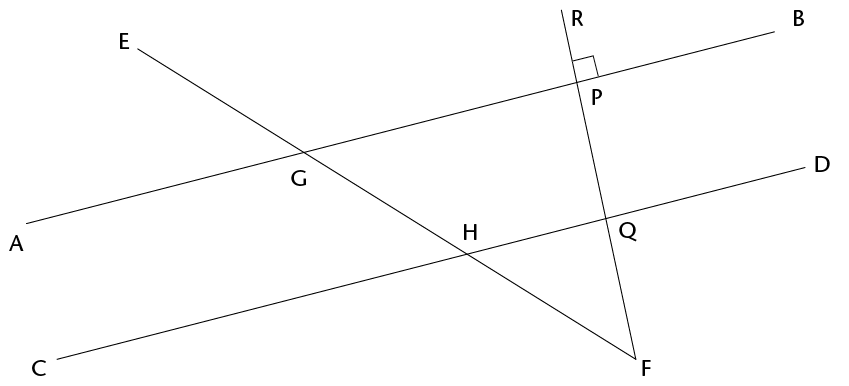
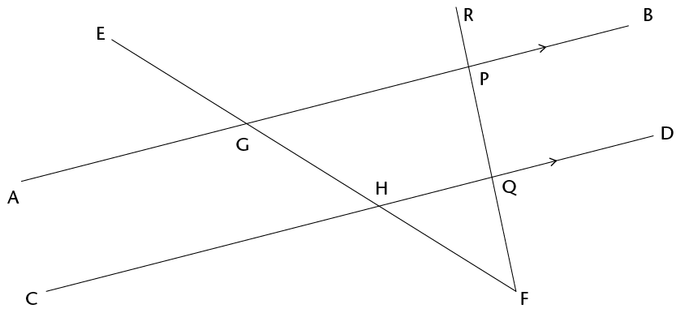

## Identify and name angles

2. In the figure below, the line
             RF is perpendicular to AB.
   
   2. Is RF also perpendicular to CD? Justify
                    your answer.
   4. Name four pairs of supplementary angles
                    in the figure. In each case say how you know that the angles
                    are supplementary.
   6. Name four pairs of co-interior angles in
                    the figure.
   8. Name four pairs of corresponding angles
                    in the figure.
   10. Name four pairs of alternate angles in
                    the figure.
4. Now you are given that AB and
             CD in the figure below are parallel.
   
   2. If it is also given that RF is
                    perpendicular to AB, will RF also be perpendicular to CD?
                    Justify your answer.
   4. Name all pairs of supplementary angles
                    in the figure. In each case say how you know that the angles
                    are supplementary.
   6. Suppose \(\text{E}\)\(\hat{\text{G}}\)\(\text{A}\) = x. Give the size of as many
                    angles in the figure as you can, in terms of x. Each time give a reason for
                    your answer.
