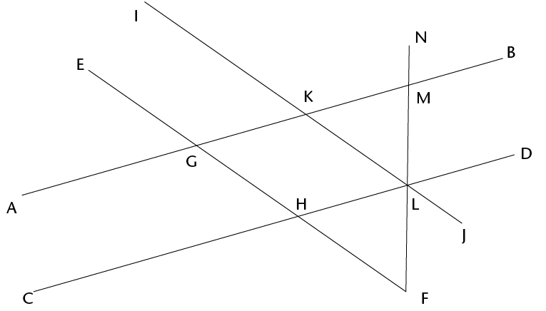
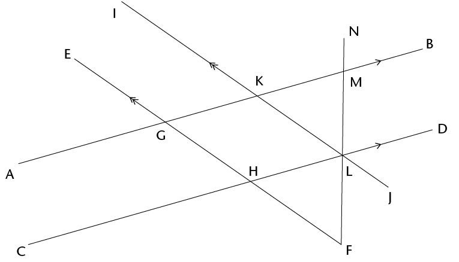
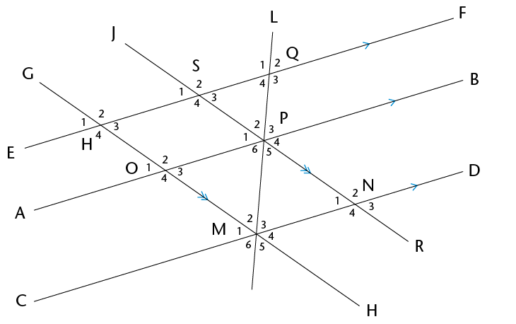

## Solving problems

2. Line segments AB and
             CD in the figure below are parallel. EF and IJ are also
             parallel. Mark these facts on the figure, and then answer the
             questions.
   <Callout type="note" title="Note">
   When you solve problems in
                 geometry you can use a shorthand way to write your reasons.
                 For example, if two angles are equal because they are
                 corresponding angles, then you can write (corr \(\angle\)s, AB
                 \(||\) CD) as the reason.
   </Callout>
   
   2. Name five angles in the figure that are
                    equal to \(\text{G}\)\(\hat{\text{H}}\)\(\text{D}\) . Give a reason for each of your
                    answers.
   4. Name all the angles in the figure that
                    are equal to \(\text{A}\)\(\hat{\text{G}}\)\(\text{H}\) . Give a reason for each of your
                    answers.
4. AB and CD in the
             figure below are parallel. EF and IJ are also parallel.
             \(\text{N}\)\(\hat{\text{M}}\)\(\text{B}\) = 80\(^\circ\) and
             \(\text{J}\)\(\hat{\text{L}}\)\(\text{F}\) = 40\(^\circ\).
   
   Find the sizes of as many angles in the
               figure as you can, giving reasons.
6. In the figure below,
             AB \(||\) CD; EF \(||\) AB; JR
             \(||\) GH. You are also given that \(\text{P}\)\(\hat{\text{M}}\)\(\text{N}\) = 60\(^\circ\), \(\text{R}\)\(\hat{\text{N}}\)\(\text{D}\) = 50\(^\circ\).
   2. Find the sizes of as many angles in the
                    figure as you can, giving reasons.
      
   4. Are EF and CD parallel? Give reasons for
                    your answers.
