# Chapter 14: Pythagoras' theorem

**theorem**
      is a rule or a statement that has been proved through
      reasoning. Pythagoras' Theorem is a rule that applies only to
      **right-angled triangles**. The theorem is named after the
      Greek mathematician, Pythagoras.**hypotenuse**.

#### Pythagoras (569-475 BC)

Pythagoras was an influential mathematician. like many Greek mathematicians of 2500 years ago, he was also a philosopher and a scientist. He formulated the best known theorem, today known as Pythagoras' Theorem. However, the theorem had already been in use 1000 years earlier, by the Chinese and Babylonians.

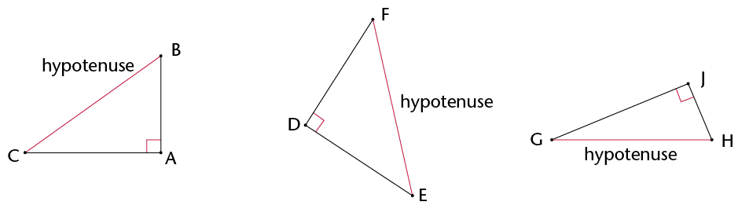

The **hypotenuse** is
        the side opposite the 90\(^\circ\) angle in a right-angled
        triangle. It is always the longest side.

**How to say it:**

'high -
        pot - eh -
        news'

The figure shows a
        right-angled triangle with squares on each of the sides.

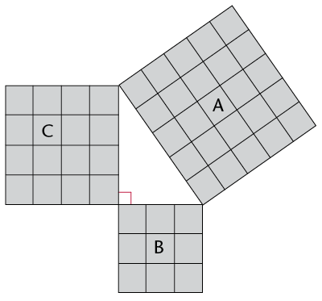

2. Write down the areas of
               the following:
   Square A:
   Square B:
   Square C:
4. Add Area of square B + Area of square
               C:
6. What do you notice about the areas?

The figure below is
        similar to the one in question 1. The lengths of the sides of
        the right-angled triangle are 5 cm and 12 cm.

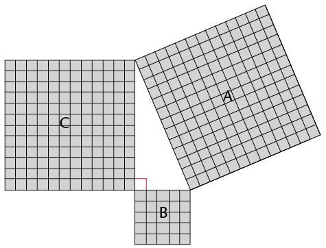

2. What is the length of the hypotenuse?
               Count the squares.
4. Use the squares to find the
               following:
   Area of A:
   Area of B:
   Area of C:
   Area of B + Area of C:
6. What do you notice about the areas? Is
               it similar to your answer in 1(c)?

A right-angled
        triangle has side lengths of 8 cm and 15 cm. Use your findings
        in the previous questions to answer the following
        questions:

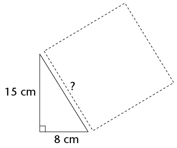

2. What is the area of the square drawn
               along the hypotenuse?
4. What is the length of the triangle's
               hypotenuse?
   In the previous activity, you
                 should
                 have discovered Pythagoras' Theorem for right-angled
                 triangles.
   <Callout type="note" title="Note">
   **Pythagoras' Theorem**
                   says:
   In a right-angled triangle,
                   a square formed on the hypotenuse will have the same area as
                   the sum of the area of the two squares formed on the other
                   sides of the triangle. Therefore:
   \((\text{Hypotenuse})^2 =
                   (\text{Side 1} )^2 + (\text{Side 2})^2\)
   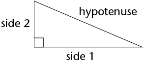
   </Callout>

 If a
        triangle is right-angled, the sides will have the following
        relationship: \(\text{(Hypotenuse)}^{2}\) = \(\text{(Side 1)}^{2}\) + \(\text{(Side 2)}^{2}\)

 If the
        sides have the relationship: \(\text{(Longest side)}^{2}\) = \(\text{(Side 1)}^{2}\) + \(\text{(Side 2)}^{2}\), then the triangle is a
        right-angled triangle.
**Example:**

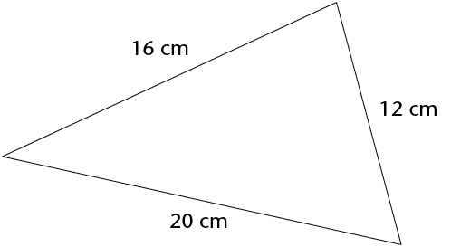

 This triangle's side
        lengths are 29 mm, 20 mm and 21 mm. Prove that it is a
        right-angled triangle.

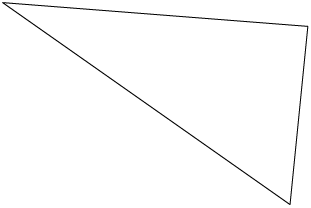

Use Pythagoras'
        Theorem to determine whether these triangles are right-angled.
        All values are in the same units.

2. 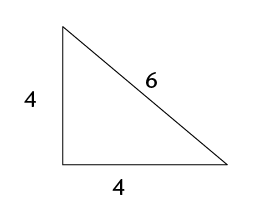
4. 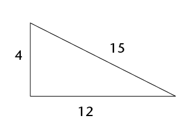
6. 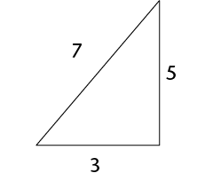

Determine whether the
        following side lengths would form right-angled triangles. All
        values are in the same units.

2. 7, 9 and 12
4. 7, 12 and 14
6. 16, 8 and 10
8. 6, 8 and 10
10. 8, 15 and 17
12. 16, 21 and 25

**Example:**

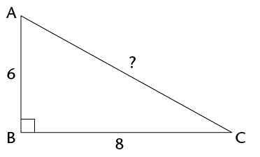

**surd**.

**Surd form**

You pronounce surd so that it rhymes with
        word.

\(\sqrt{5}\) is an example of a number in surd
        form.

\(\sqrt{9}\) is not a surd because you can
        simplify it:

\(\sqrt{9}\) = 3

**Example:**

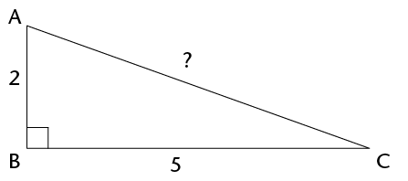

Find the length of the
        hypotenuse in each of the triangles below. Leave the answers in
        surd form where applicable.

2. 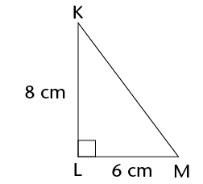
4. 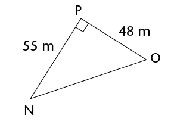
6. 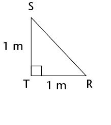
8. 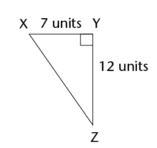

A rectangle has sides
        with lengths 36 mm and 77 mm. Find the length of the
        rectangle's diagonal.

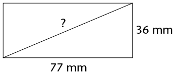

\(\triangle\)ABC has \(\hat{A}\) = 90\(^\circ\), AB = 3 cm and AC = 5
        cm. Make a rough sketch of the triangle, and then calculate the
        length of BC.

A rectangular prism is
        made of glass. It has a length of 16 cm, a height of 10 cm and
        a breadth of 8 cm. ABCD and EFGH are two of its faces.
        \(\triangle\)ACH has been drawn inside the prism. Is \(\triangle\)ACH
        right-angled? Answer the questions to find out.

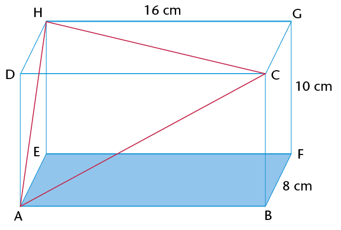

2. Calculate the length of the sides of
               \(\triangle\)ACH. Note that all three sides of the triangles are
               diagonals of rectangles. AC is in rectangle ABCD, AH is in ADHE
               and HC is in HDCG.
4. Is \(\triangle\)ACH right-angled? Explain
               your answer.

**Example:**

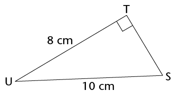

In the right-angled
        triangles below, calculate the length of the sides that have
        not been given. Leave your answers in surd form where
        applicable.

2. 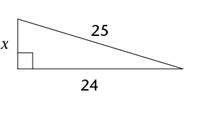
4. 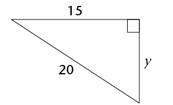
6. 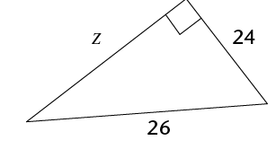

Calculate the length
        of the third side of each of the following right-angled
        triangles. First draw a rough sketch of each of the triangles
        before you do any calculations. Round off your answers to two
        decimal places.

2. \(\triangle\)ABC has AB = 12 cm, BC = 18 cm
               and \(\hat{A}\) = 90\(^\circ\). Calculate AC.
4. \(\triangle\)DEF has \(\hat{F}\)= 90\(^\circ\), DE = 58 cm and DF = 41
               cm. Calculate EF.
6. \(\triangle\)JKL has \(\hat{K}\) = 90\(^\circ\), JK = 119 m, KL = 167 m.
               Calculate JL.
8. \(\triangle\)PQR has PQ = 2 cm, QR
               = 8 cm and \(\hat{Q}\) = 90\(^\circ\). Calculate PR.

2. A ladder of length 5 m is placed at
               an angle against a wall. The bottom of the ladder is 1 m away
               from the wall. How far up the wall will the ladder reach? Round
               off to two decimal places.
   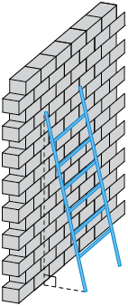
4. If the ladder reaches a height of 4,5 m
               against the wall, how far away from the wall was it placed?
               Round off to two decimal places.

Sets of **whole numbers** that can be used as the
        sides of a right-angled triangle are known as
        **Pythagorean triples**, for example:

3-4-5 ;5-12-13 ;7-24-25 ;16-30-34 ;20-21-29

You
        extend these triples by finding multiples of them. For
        examples, triples from the 3-4-5 set include the
        following:

3-4-5 ;6-8-10 ;9-12-15 ;12-16-20

There are many old writings that record Pythagorean
        triples. For example, from 1900 to 1600 BC the
        Babylonians had already calculated very large
        Pythagorean triples, such as:

1
        679-2 400-2 929.

How many Pythagorean
        triples can you find? What is the largest one you can
        find that is not a multiple of another one?

Four lines have been
        drawn on the grid below. Each square is 1 unit long. Calculate
        the lengths of the lines: AB, CD, EF and GH. Do the
        calculations in your exercise book and write the answers below.
        Leave your answers in surd form.

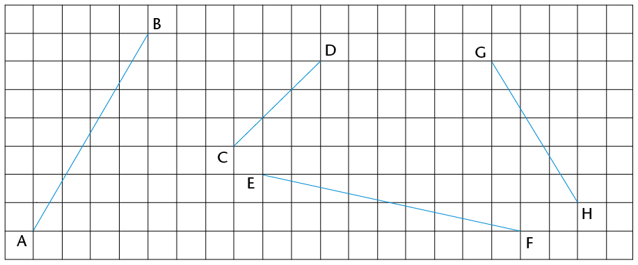

2. Calculate the area of rectangle
               KLMN.
   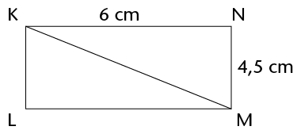
4. Calculate the perimeter of
               \(\triangle\)KLM.

ABCD is a rectangle
        with AB = 4 cm, BC = 7 cm and CQ = 1,5 cm. Round off your
        answers to two decimal places if the answers are not whole
        numbers.

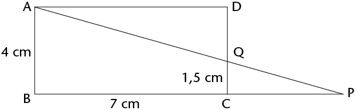

2. What is the length of QD?
4. If CP = 4,2 cm, calculate the length of
               PQ.
6. Calculate the length of AQ and the area
               of \(\triangle\)AQD.

MNST is a
        parallelogram. NR = 9 mm and MR = 12 mm.

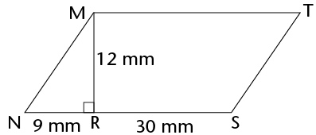

2. Calculate the area of \(\triangle\)MNR.
4. Calculate the perimeter of MNST.

Pythagoras' Theorem works
        only for right-angled triangles. But we can also use it
        to find out whether other triangles are acute or
        obtuse, as follows.

- **If the square of
              the longest side is less than the sum of the squares
              of the two shorter sides, the biggest angle is
              acute** .

For example, in a 6-8-9 triangle: \(6^{2}\) + \(8^{2}\) = 100 and
        \(9^{2}\) =
        81.

81
        is less than 100 \(\therefore\) the
        6-8-9 triangle is acute.

- **If the square of
              the longest side is more than the sum of the squares
              of the two shorter sides, the biggest angle is
              obtuse** .

For example, in a 6-8-11 triangle: \(6^{2}\) + \(8^{2}\) = 100 and
        \(11^{2}\) =
        121.

121 is more than 100 \(\therefore\) the
        6-8-11 triangle is obtuse.

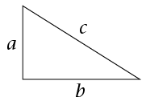

Complete the following table. It is based on the
        triangle on the right. Decide whether each triangle
        described is right-angled, acute or obtuse.

| \(a\) | \(b\) | \(c\) | \(a^{2} + b^{2}\) | \(c^{2}\) | Fill ini =, > or
                < | Type of
                triangle |
| --- | --- | --- | --- | --- | --- | --- |
| 3 | 5 | 6 | \(3^{2} + 5^{2}
                = 9 + 25 = 34\) | \(6^{2}\)
                = 36 | \(a^{2} + b^{2} \gt c^{2}\) | Acute |
| 2 | 4 | 6 |  |  | \(a^{2} + b^{2}\) ........... \(c^{2}\) |  |
| 5 | 7 | 9 |  |  | \(a^{2} + b^{2}\) ...........
                \(c^{2}\) |  |
| 12 | 5 | 13 |  |  | \(a^{2} + b^{2}\) ........... \(c^{2}\) |  |
| 12 | 16 | 20 | \(12^{2} + 16^{2}
                = 144 + 256 = 400\) | \(20^{2} = 400\) | \(a^{2} + b^{2}\) ...........
                \(c^{2}\) | Right-angled |
| 7 | 9 | 11 |  |  | \(\text{a}^{2}\) +
                \(\text{b}^{2}\) ........... \(\text{c}^{2}\) |  |
| 8 | 12 | 13 |  |  | \(\text{a}^{2}\) +
                \(\text{b}^{2}\) ........... \(\text{c}^{2}\) |  |

2. Write down Pythagoras' Theorem in the way that
             you best understand it.
4. Calculate the lengths of the
             missing sides in the following triangles. Leave the answers in
             surd form if necessary.
   2. 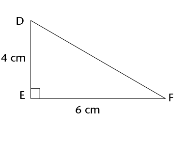
   4. 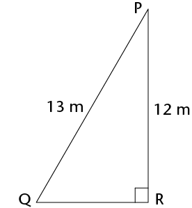
6. ABCD is a parallelogram.
   2. Calculate the perimeter of
                    ABCD.
      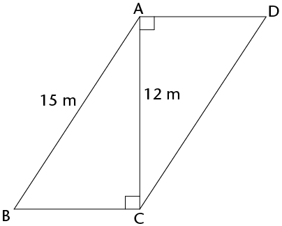
   4. Calculate the area of ABCD.
