# Chapter 15: Area and perimeter of 2d shapes

In this chapter, you will
        revise how to calculate the perimeter and area of
        squares, rectangles, triangles and circles. The perimeter of a
        shape is the distance all the way around the sides of the shape.
        The area of a shape is the flat space inside the shape. You
        will also learn how to calculate the areas of parallelograms,
        rhombi, kites and trapeziums, as well as investigate the effect
        on the perimeter and area of a shape when its dimensions are
        doubled.

Each block in figures
        A to F below measures 1 cm \(\times\) 1 cm. What is the perimeter
        and area of each of the figures? Complete the table below.

<Callout type="note" title="Note">
The **perimeter**
            (*P*) of a shape is
            the distance along the sides of the shape. The **area**
            (*A*) of a figure is
            the size of the flat surface enclosed by the figure.
</Callout>

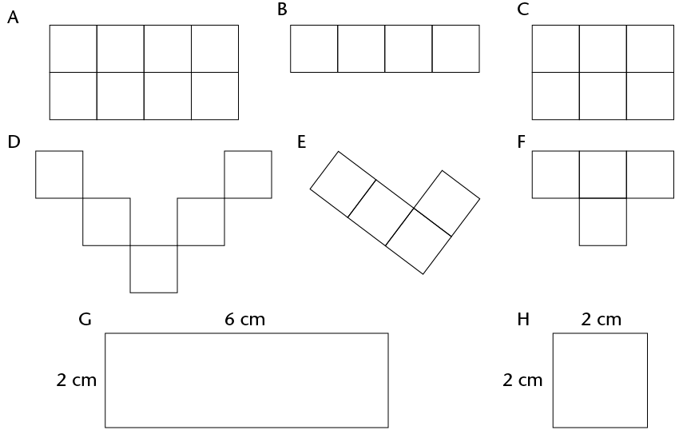

| Figure | Perimeter | Area | Number of 1 cm \(\times\)
                    1 cm squares |
| --- | --- | --- | --- |
| A |  |  |  |
| B |  |  |  |
| C |  |  |  |
| D |  |  |  |
| E |  |  |  |
| F |  |  |  |
| G |  |  |  |
| H |  |  |  |

Consider the rectangle
        below. It is formed by tessellating identical squares that are
        1 cm by 1 cm each. The white part has squares that are
        hidden.

<Callout type="note" title="Note">
To **tessellate** means to
            cover a surface with identical shapes in such a way that
            there are no gaps or overlaps. Another word for tessellating
            is **tiling**.
</Callout>

2. Write down, without counting, the total
               number of squares that form this rectangle, including those
               that are hidden.
               Explain your reasoning.
   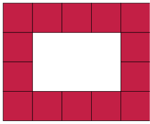
4. What is the area of the rectangle,
               including the white part?

<Callout type="note" title="Note">
Area of a rectangle =
            length \(\times\) breadth = \(l \times b \)

Area of a square = \(l
            \times l = l^{2}\)

<Callout type="note" title="Note">
Both length (*l*) and breadth (*b*) are expressed in the same
              unit.
</Callout>
</Callout>

Sipho and Theunis each
        paint a wall to earn some money during the school holidays.
        Sipho paints a wall 4 m high and 10 m long. Theunis's wall is 5
        m high and 8 m long. Who should be paid more? Explain.

What is the area of a square
        with a length of 12 mm?

The area of a rectangle is 72
        cm2 and its length
        is 8 cm. What is its breadth?

The diagram on the left below
        shows the floor plan of a room.

2. We can calculate the area of the room by
               dividing the floor into two rectangles, as shown in the diagram
               on the right below.
   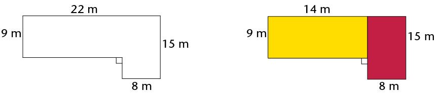
   Area of the room = Area of yellow rectangle
                 + Area of red rectangle
   \(= (l \times b) + (l \times b)\\
                 = (14 \times 9) + (15 \times 8)\\
                 = 126 + 120\\
                 = 246 \text{ m}^{2}\)
4. The yellow part of the room has a wooden
               floor and the red part is carpeted. What is the area of the
               wooden floor? What is the area of the carpet?
6. Calculate the area of the room using two
               different shapes. Draw a sketch.
   

Calculate the area of the
        figures below.

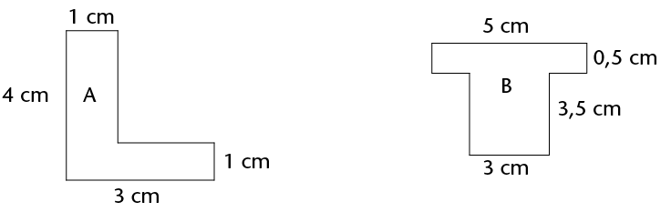

Which of the following
        rules can be used to calculate the perimeter (*P*) of a
        rectangle? Explain.

- Perimeter
              \(= 2 \times (l + b) \)
- Perimeter
              \( = l + b + l + b \)
- Perimeter
              \( = 2l + 2b \)
- Perimeter \( = l + b \)

<Callout type="note" title="Note">
l and b refer to the length and
            the breadth of a rectangle.
</Callout>

<Callout type="note" title="Note">
The following are
            equivalent expressions for perimeter:

\(P = 2l + 2b \) and \(P-2(l + b)\) and \(P = l + b +l+b\)
</Callout>

Check with two classmates that the rule or rules you have chosen abover are correct ;then apply it to calculate the perimeter of figure A. Think carefully!

The perimeter of a rectangle is 28 cm and its breadth is 6 cm. What is its
        length?

**circumference** of a circle. You will remember the
      following aboutcircles from previous grades: The
        distance across the circle through its centre is called the
        **diameter** (*d*) of the circle.
 The
        distance from the centre of the circle to any point on the
        circumference is called the **radius** (*r*).

 The
        circumference (*c*) of a circle divided by its
        diameter is equal to the irrational value we call **pi**
        \((\pi)\). To simplify calculations, we often use the
        approximate values 3,14 or \(\frac{22}{7}\)

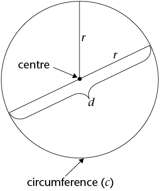

The following are important
        formulae to remember:

- \(d = 2 \pi r\) and \(r= \frac{1}{2}d\)
- Circumference of a circle \((c) = 2 \pi r \)
- Area of a circle \( (A) = \pi r^{2}\)

Calculate the perimeter and
        area of the following circles:

2. A circle with a radius of 5 m
4. A circle with a diameter of 18 mm

 Calculate the radius of a
        circle with:

2. a circumference of 53 cm
4. a circumference of 206 mm

Work out the area of the
        following shapes:

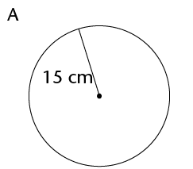

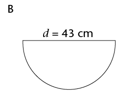

Calculate the radius and
        diameter of a circle with:

2. an area of 200 m2
4. an area of 1 000 m2

Calculate the area of the
        shaded part.

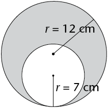

Remember:

1 cm = 10 mm 1 mm = 0,1 cm

1 m = 100 cm 1 cm = 0,01 m

1 km = 1 000 m 1 m = 0,001
        km

Convert the following:

2. 34 cm = .......... mm
4. 501 m = .......... km
6. 226 m = .......... cm
8. 0,58 km = .......... m
10. 1,9 cm = .......... mm
12. 73 mm = .......... cm
14. 924 mm = .......... m
16. 32,23 km = .......... m

2 to m2:
      1 cm \(\times\) 1 cm
      =0.01 m \(\times\) 0.01 m
      =0.0001 m2 **Example:**
      Convert 50 cm2to m2
      1 cm2 = 0,0001 m2

      50 cm2 = 50 \(\times\)
      0,0001 m2

      = 0,005 m2
Convert to cm2:

2. 650 mm2
4. 1 200 mm2
6. 18 m2
8. 0,045 m2
10. 93 mm2
12. 177 m2

2. Convert 93 mm2 to m2
4. Convert 0,017 km2 to m2

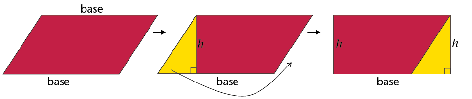

\(\therefore\) Area of
        parallelogram = base \(\times\) perp. height

We can use any side of the
        parallelogram as the base, but we must use the perpendicular
        height on the side we have chosen.

2. Copy the parallelogram above into your exercise book.
4. Using the shorter
               side as the base of the parallelogram, follow the steps above
               to derive the formula for the area of a parallelogram.

Work out the area of the
          following parallelograms using the formula.

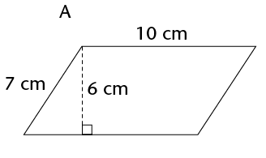

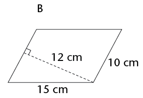

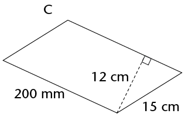

Work out the area of
        the parallelograms. Use the Theorem of Pythagoras to calculate
        the unknown sides you need. Remember to use the pre-rounded
        value for height and then round the final answer to two decimal
        places where necessary.

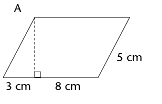

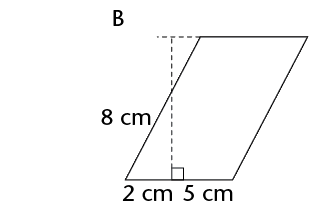

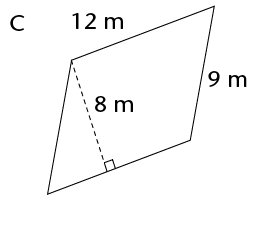

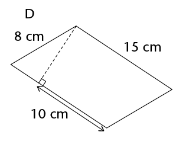

Area of a rhombus = length
        \(\times\) perp. height

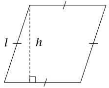

Work in your exercise
        book. Show how to derive the formula for the area of a
        rhombus.

Calculate the areas of
        the following rhombi. Round off answers to two decimal places
        where necessary.

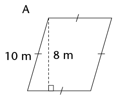

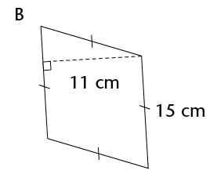

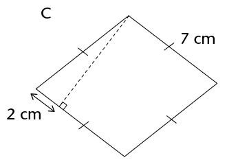

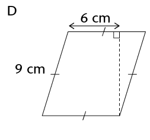

\(\triangle\)DEG + Area
      of \(\triangle\)EFG

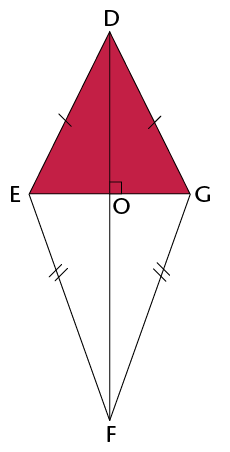

\(\therefore\) Area of a
        kite = \(\frac{1}{2}\) (diagonal 1 \(\times\) diagonal 2)

Calculate the area of kites
        with the following diagonals. Give your answers in m2

2. 150 mm and 200 mm
4. 25 cm and 40 cm

Calculate the area of the
        kite.

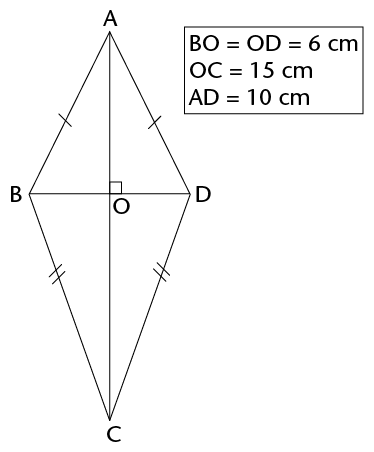

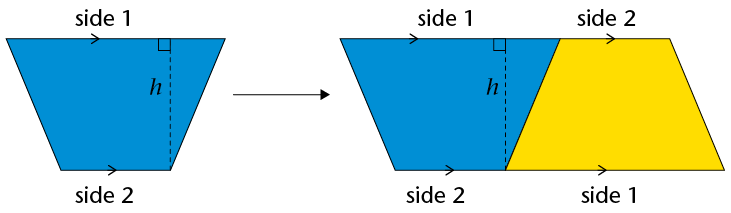

\(\therefore\) Area of a
        trapezium = \(\frac{1}{2}\) (sum of parallel sides) \(\times\) perp.
        height

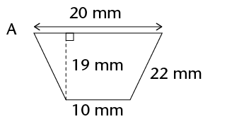

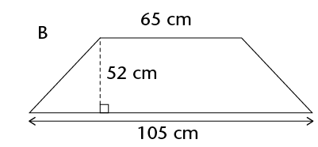

Calculate the areas of the following
        2D shapes. Round off your answers to two decimal places where
        necessary.

2. 
4. 
6. 
8. 

 length and
        breadth for rectangles and squares
 bases and
        perpendicular heights for triangles, rhombi and
        parallelograms
 two
        diagonals for kites.

Doubling means to multiply by
        2.

Work out the perimeter
        and area of each shape. Round off your answers to two decimal
        places where necessary.
Which
        figure in each set is congruent to the original figure?

Fill in the perimeter
        (*P*) and area (*A*) of each figure in the table
        below.

| Figure | Original figure | Figure with both
                  dimensions doubled |
| --- | --- | --- |
| A | P = A = | P = A = |
| B | P = A = | P = A = |
| C | P = A = | P = A = |
| D | P = A = | P = A = |

Look at the completed table
        above. What patterns do you notice? Choose one:
 When both
        dimensions of a shape are doubled, its **perimeter is
          doubled** and its **area is doubled**.

        When both
        dimensions of a shape are doubled, its **perimeter is
          doubled** and its area is **four times bigger**.

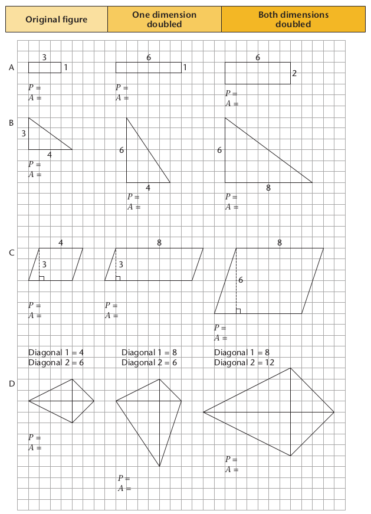

2. Write down
             the formulae for the following:
   | Perimeter of a square |  |
   | --- | --- |
   | Perimeter of a rectangle |  |
   | Area of a square |  |
   | Area of a rectangle |  |
   | Area of a triangle |  |
   | Area of a rhombus |  |
   | Area of a kite |  |
   | Area of a parallelogram |  |
   | Area of a trapezium |  |
   | Diameter of a circle |  |
   | Circumference of a circle |  |
   | Area of a circle |  |
4. 2. Calculate the perimeter of the square and the area of the shaded
                      parts of the square.
      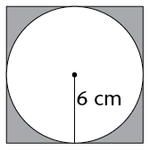
   4. Calculate the area of the kite.
      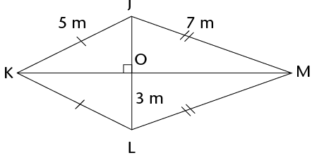
