# Chapter 16: Term 2 revision and assessment

Construct and label the
        following triangles and quadrilaterals:

2. Triangle FGH where GH = 6,2 cm;
               \(\hat{G}\) = 36\(^\circ\) and \(\hat{H}\) = 63\(^\circ\)
4. Parallelogram PQRS where PQ = 5,7 cm, PS
               = 7,8 cm and \(\hat{R}\) = 112\(^\circ\)

2. Construct \(\triangle\)KLM where KL = 9,4 cm; LM = 7 cm and MK = 7,8 cm.
4. Construct the
               perpendicular bisectors of all three sides of the triangle
               drawn in part (a). You should find that they all go through the
               same point.
6. Use the point of intersection as the
               midpoint of a circle that passes through all three vertices of
               the triangle. Use your compass to draw this circle.

Construct the following angles
        without using a protractor:

2. 45\(^\circ\)
4. 210\(^\circ\)

Construct a regular hexagon in
        your exercise books by following these instructions:

- Construct
              a horizontal line, AB, which is 2 cm long.
- Set your
              compass to 2 cm, and from each of A and B, draw an arc above
              line AB. Call the point that the arcs intersect O.
- Draw a
              circle of radius 2 cm, centred on O. It should go through A
              and B.
- Place the
              compass on point B, and draw an arc crossing the circle on
              the side opposite to A. Call this point C.
- Repeat the
              above step to create points D to F.
- Join B to
              C with a straight line. Repeat with C to D, and so on, until
              you get back to point A. You have now constructed a regular
              hexagon!

The following table summarises the properties of diagonals of quadrilaterals. Complete the table by placing ticks in the appropriate blocks.

|  | Parallelogram | Rectangle | Square | Rhombus | Trapezium | Kite |
| --- | --- | --- | --- | --- | --- | --- |
| Diagonals bisect each
                  other |  |  |  |  |  |  |
| Diagonals cut at right
                  angles |  |  |  |  |  |  |

Study the following
          figure.

          Note that \(d\), \(e\) and \(f\) are the exterior angles of the
          triangle.

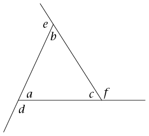

2. Write down an equation that shows the
               relationship between angle d and the sum of two other
               angles in the image.
4. Determine the size of d + e + f. Give reasons for your
               answer.

Determine the size of
        \(\hat{V}\). Show all steps of your working and give
        reasons when using any geometrical theorem:

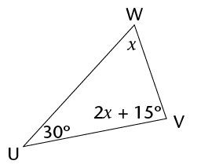

DEFG is a square with
        DF = 12 cm. Determine the length of the side of the square,
        correct to two decimal places. Show all steps of your working.
        Give reasons when using any geometrical theorem:

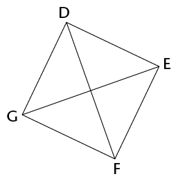

Are the following
        pairs of triangles congruent? If they are, write down the
        relationship in the form \(\triangle\)XYZ \(\equiv\) \(\triangle\)ORQ, where X corresponds with O, Y with R, and so
        on. Also state the congruency condition (case) that proves the
        two triangles are congruent (for example, sss). If they are not
        congruent, explain why they are not congruent.

**Note**: the triangles are not
          drawn to scale.

2. 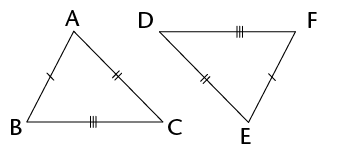
4. 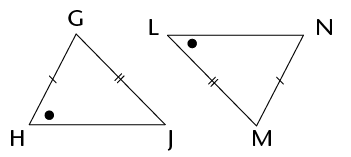

Provide a formal proof that
        the two triangles in the diagram below are congruent:

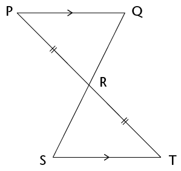

Study the diagram
        alongside:

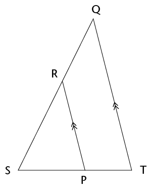

Prove that \(\triangle\)SRP \(|||\)
          \(\triangle\)SQT.

Determine the size of \(P\hat{M}Q\).

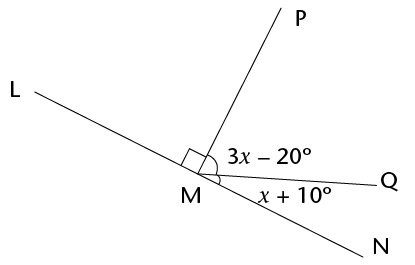

Determine the size of
        \(x\) in each case. Show
        all steps of your working and give reasons when using any
        geometrical theorem:

2. 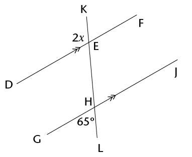
4. Given: EH = EJ
   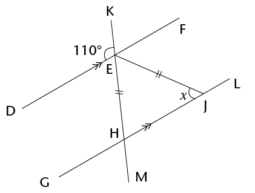
6. \(A\hat{B}G = x\); \(B\hat{C}D = 130^\circ\) and \(C\hat{D}J = 72^\circ\)
   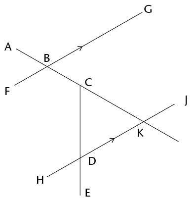
8. 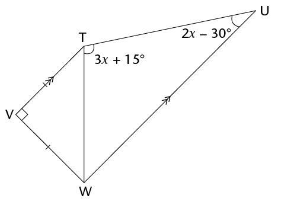

For which value of
        \(x\) are AB and CD parallel? Show all steps of your working
        and give reasons when using any geometrical theorem.

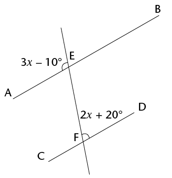

Calculate the missing side
        length in each of the following triangles:

2. 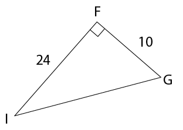
4. 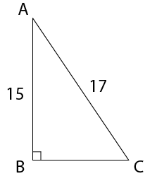

 A river is 50 m
        wide. Assume that the river flows completely straight. If
        Camelia swims across the river to a point on the bank 12
        m downstream from the point directly opposite her, how far will
        she swim? Give your answer correct to one decimal place.

Triangle LMN is
        isosceles, with LM = LN. MN = 36 cm and LP = 24 cm. Determine
        the perimeter of the triangle.

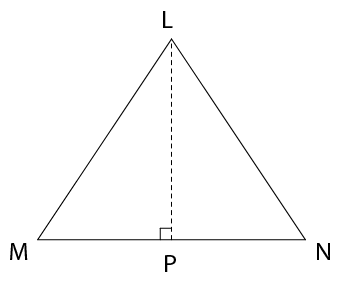

DEFG is a rectangle,
        with DE = 20 cm and diagonal EG = 101 cm. Determine the area of
        the rectangle.

Is it possible to have
        a right-angled triangle with the following side lengths: 36; 76
        and 84? Show all working necessary to support your answer.

Determine (i) the
        perimeter, and (ii) the area, of each of the following shapes.
        If necessary, give your answers in centimetres or square
        centimetres, correct to one decimal place:

2. BF = 8 cm; BC = 10 cm; FD = 6 cm
   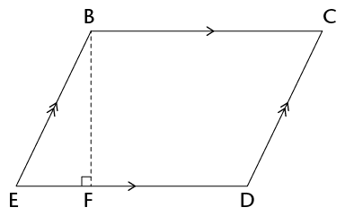
4. GI = 12 cm; JK = 6 cm and JK : KH = 1 :
               2
   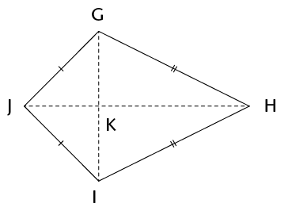
6. The shape alongside is that of a
                 window, consisting of a rectangular section HJKL, and a
               semi-circular top section. HJ = 0,5 m and JK = 0,2 m.
   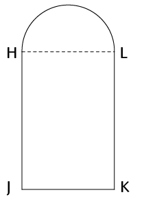

A button is made in
        the shape of a circle, with two congruent rectangles cut out,
        as shown in the diagram. The diameter of the button is 25 mm
        and the dimensions of each rectangle are 12 mm by 3 mm.
        Calculate the area of the top surface of the button in square
        centimetres.

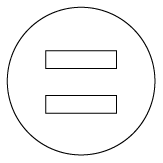

A rectangle has length
        \(3d\) and width
        \(7e\). Write simplified
        expressions for the:

2. Area of the rectangle
4. Perimeter of the rectangle

Complete the unshaded blocks in following table to show the
        impact on the perimeter and area of doubling one dimension of the shape (for
        a rectangle, the length; for a triangle, the base; and for a
        circle, the radius). Assume that the original perimeter
        was \(x\), and the original area was \(y\). One answer has already
        been added for you.

|  | Rectangle | Triangle | Circle |
| --- | --- | --- | --- |
| New
                  perimeter/circumference |  |  |  |
| New area | \(2y\) |  |  |

2. Construct a triangle RST with RS = 7,3 cm, \(\hat{R}\) = 42\(^\circ\); and \(\hat{S}\) = 67\(^\circ\). (
   Use a protractor and ruler to check
                   that the learners' constructions are accurate. Allow an error
                   of up to 1 mm and 1\(^\circ\).
4. Construct the bisectors of
               each of the angles of the triangle that you constructed in part
               (a). You should find that they have a common point of
               intersection.
6. Use the common point of
               intersection of the bisectors of the angles that you
               constructed in part (b) as the midpoint of a circle touching
               all three sides of the triangle. Use your compass to draw this
               circle.
8. Is it always possible to draw
               a triangle given the length of one of the lines and the sizes
               of the angles adjacent to that line (as was given in part (a),
               for example)? Explain your answer.
10. Construct the following angle
               without using a protractor: 150\(^\circ\).
12. Mthunzi is thinking of a
               quadrilateral and provides the following clue to Sam: "Its
               diagonals cut perpendicularly, but not all the sides of the
               shape are equal in length." Help Sam by writing down the
               special name of the shape.
14. Look at the figure below.
               Write down an equation, and use it to determine the size of
               *x*. (3)
   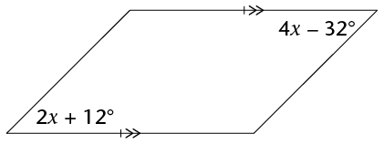

Study the diagram
        alongside:

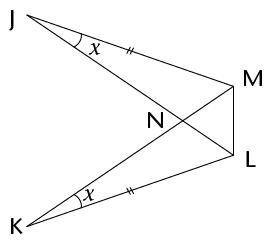

2. Prove that \(\triangle\)JNM
               \(\equiv\)
               \(\triangle\)KNL.
4. Do you have enough
               information to prove that \(\triangle\)JLM \(\equiv\)
               \(\triangle\)KML? Explain your answer.
6. Study the diagram alongside:
   Given that \(\triangle\)CDE
                 \(\equiv\)
                 \(\triangle\)FCG, prove that ED \(||\) GF. Give
                 reasons for all statements.
   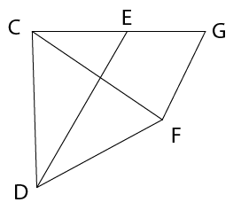

Study the diagram below. All
        numerical values represent lengths of sides:

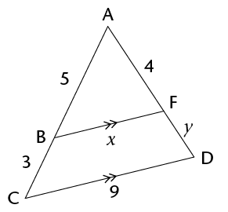

2. Briefly explain why
               \(\triangle\)ABF \(|||\) \(\triangle\)ACD (a full
               proof is NOT required).
4. Use the similarity of the
               triangles to determine the lengths of the line segments
               (correct to one decimal place).
   2. \(x\)
   4. \(y\)

Study the diagram alongside.
        Determine, with reasons, the size of \(\hat{U}\) in terms of \(x\).

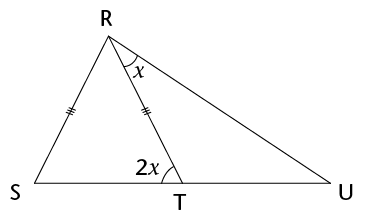

 Study the diagram alongside.
        Given that MK = ML, determine, with reasons, the value of
        *z*.

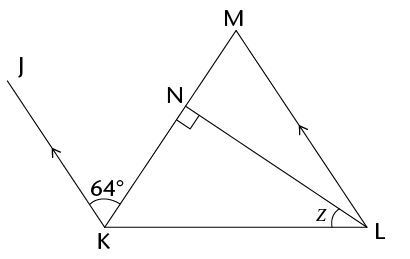

Is AC \(||\) DF?
        Explain your answer by means of a proof.

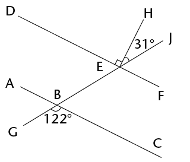

Study the diagram
        alongside. QRST is a rectangle. All numerical values represent
        lengths:

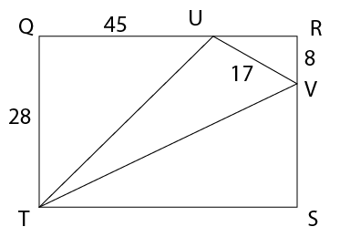

2. Calculate the length of UT.
4. Calculate the perimeter of
               triangle TUV, correct to one decimal place.

 A rectangle has an area of
        \(6a^{2}\) and a
        perimeter of \(10a\). Determine, in terms of \(a\), the
        dimensions of the rectangle.

On the grid below, draw a
        parallelogram that has the same area as the triangle.

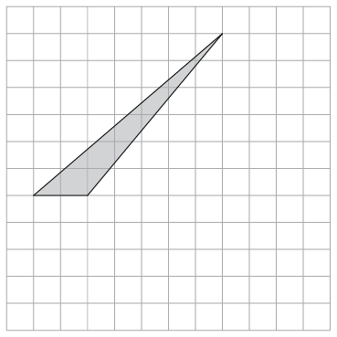

The perimeter of a
        rhombus is 60 cm, and the length of one of its diagonals is 24
        cm.

2. Calculate the length of a
               side of the rhombus.
4. Show that the area of the
               rhombus is 216 cm2.
